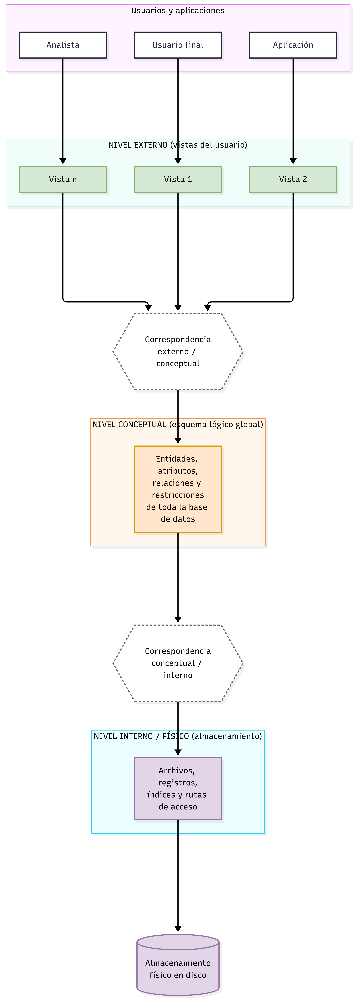
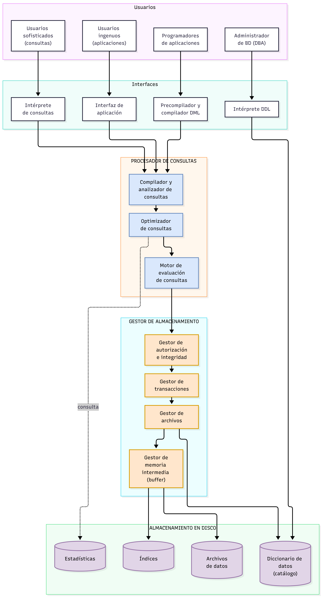

# Tarea 1.2: Clasificación de Bases de Datos y Arquitecturas (ANSI/SPARC y SGBD)

**Tecnológico Nacional de México**  
**Carrera:** Ingeniería Informática  
**Materia:** Fundamentos de Base de Datos  
**Unidad:** 1  
**Alumna:** Gabriela Natalia De León Alvarez  
**Matrícula:** I24050006  

---

## 📌 Descripción

Esta carpeta contiene la documentación, esquemas y diagramas correspondientes a la **Tarea 1.2**, desarrollada con base en las siguientes actividades de investigación:

1. **Cuadro sinóptico sobre la clasificación de las bases de datos:**  
   Investigación y elaboración de un cuadro sinóptico estructurado que clasifica los sistemas de bases de datos considerando múltiples dimensiones:
   - **Por su ubicación:** Centralizadas, distribuidas (homogéneas y heterogéneas) y en la nube (DBaaS).
   - **Por la variabilidad de los datos:** Estáticas (históricas/solo lectura) y dinámicas (lectura y escritura continua).
   - **Por el modelo de datos:** Jerárquicas, de red, relacionales, orientadas a objetos, objeto-relacionales, NoSQL y multidimensionales.
   - **Por su contenido:** Bibliográficas, de texto completo, directorios y especializadas (científicas, geográficas, multimedia).
   - **Por su propósito de uso:** Transaccionales (OLTP para operaciones diarias) y analíticas (OLAP / almacenes de datos).
   - **Por el número de usuarios:** Monousuario y multiusuario.

2. **Arquitectura de tres niveles (ANSI/SPARC) y arquitectura funcional interna del SGBD:**  
   Descripción teórica y esquematización de los modelos arquitectónicos:
   - **Arquitectura de tres niveles (ANSI/SPARC):** Nivel externo (vistas personalizadas para usuarios/aplicaciones), nivel conceptual (esquema global lógico de entidades, atributos y relaciones) y nivel interno/físico (almacenamiento en archivos, bloques e índices). Explicación de los mapeos y la garantía de independencia lógica y física de datos.
   - **Arquitectura funcional interna del SGBD:** Análisis de los módulos principales que componen el sistema gestor: el **procesador de consultas** (compilador, optimizador y motor de ejecución) y el **gestor de almacenamiento** (control de integridad, gestión de transacciones ACID, manejo de buffers y diccionario de datos).

---

## 🎥 Video explicativo

▶️ **[Ver video en YouTube](PEGA-AQUI-EL-ENLACE-DEL-VIDEO)**

El video detalla el cuadro sinóptico con los criterios de clasificación, los tres niveles de abstracción ANSI/SPARC y los componentes funcionales que operan dentro de un SGBD.

---

## 📂 Contenido de la carpeta

| Archivo | Descripción |
|---|---|
| [Tarea1.2.pdf](Tarea1.2.pdf) | Documento formal con portada institucional, cuadro sinóptico, descripciones teóricas, esquemas y referencias APA |
| [cuadro-sinoptico.md](cuadro-sinoptico.md) | Documento en Markdown con desglose analítico de los criterios de clasificación y diagrama Mermaid interactivo |
| [arquitectura-tres-niveles-y-sgbd.md](arquitectura-tres-niveles-y-sgbd.md) | Documento en Markdown que describe y esquematiza la arquitectura de 3 niveles y la arquitectura interna del SGBD |

---

## 🗺️ Vistas previas de los diagramas

### 1. Clasificación de las bases de datos (Cuadro sinóptico)

### 2. Arquitectura de tres niveles (ANSI/SPARC)

### 3. Arquitectura funcional interna del SGBD

---

## 🛠️ Herramientas utilizadas

- [draw.io (diagrams.net)](https://app.diagrams.net/) para el diseño y exportación de esquemas gráficos
- [Mermaid.js](https://mermaid.js.org/) para modelado y visualización nativa de diagramas en GitHub
- Microsoft Word / PDF para el documento académico formal
- OBS Studio para la grabación del video explicativo
- Git y GitHub para control de versiones y repositorio de evidencias

---

## 📚 Referencias (APA 7)

ANSI/X3/SPARC Study Group on Data Base Management Systems. (1975). Interim report. *FDT – Bulletin of ACM SIGMOD, 7*(2).

Date, C. J. (2004). *An introduction to database systems* (8.ª ed.). Pearson/Addison-Wesley.

Elmasri, R., & Navathe, S. B. (2016). *Fundamentals of database systems* (7.ª ed.). Pearson.

Özsu, M. T., & Valduriez, P. (2020). *Principles of distributed database systems* (4.ª ed.). Springer. https://doi.org/10.1007/978-3-030-26253-2

Silberschatz, A., Korth, H. F., & Sudarshan, S. (2010). *Database system concepts* (6.ª ed.). McGraw-Hill.

Tsichritzis, D., & Klug, A. (1978). The ANSI/X3/SPARC DBMS framework report of the study group on database management systems. *Information Systems, 3*(3), 173-191.
