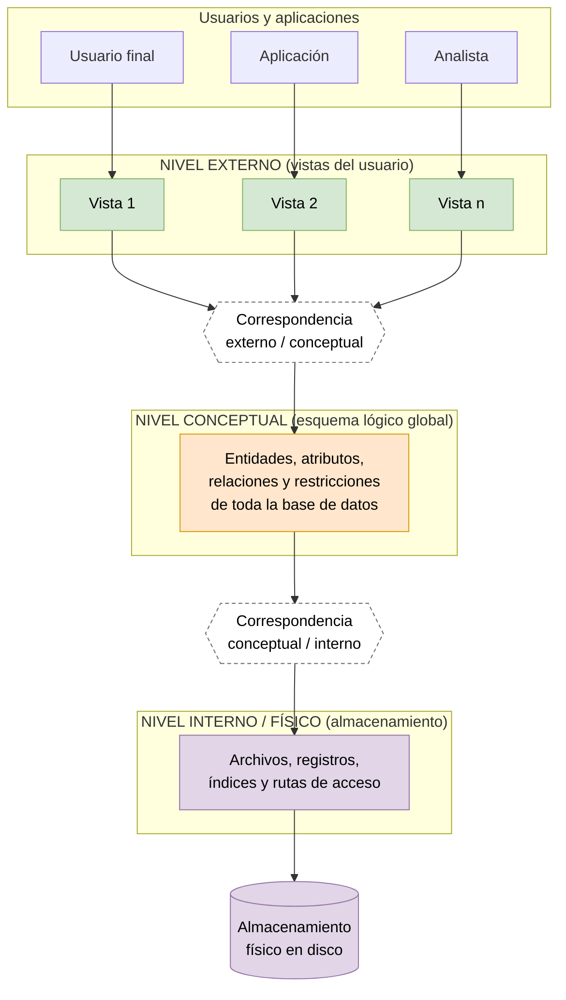
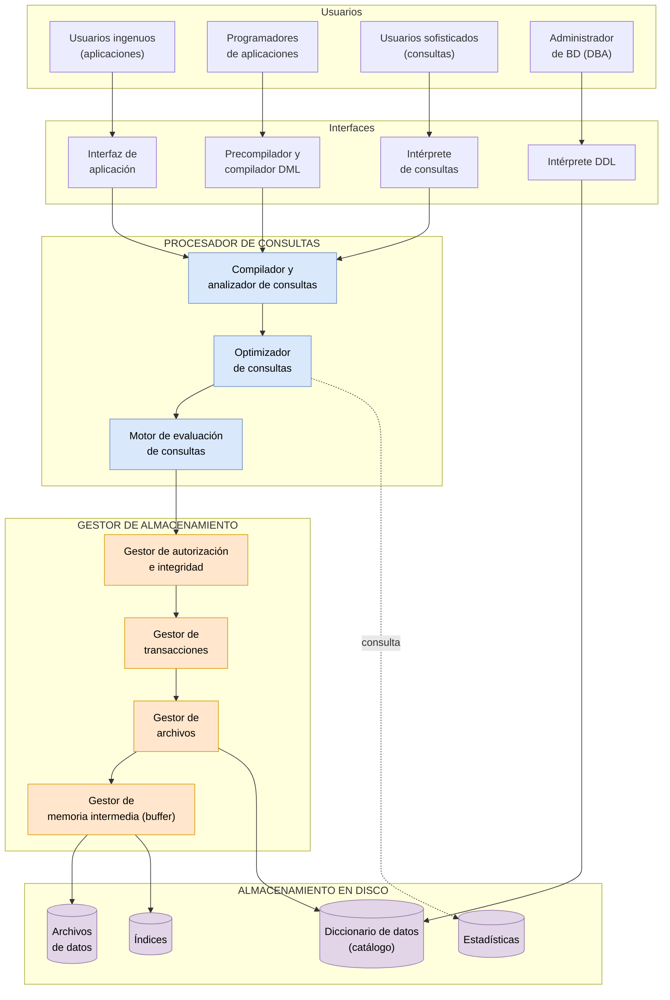
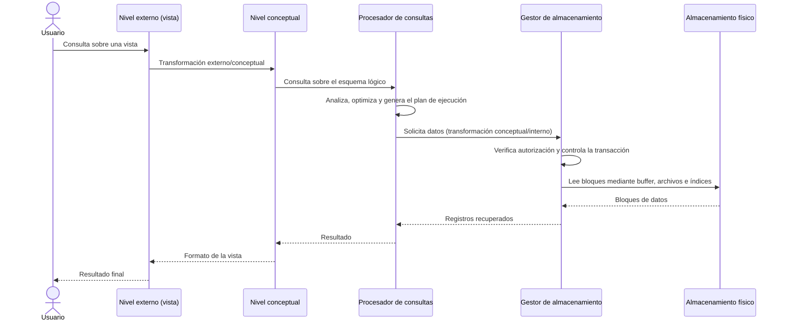

# Arquitectura de tres niveles (ANSI/SPARC) y arquitectura funcional del SGBD

> Tarea 1.2, punto 2: describe y esquematiza la arquitectura de tres niveles de una base de datos (físico, conceptual, externo) y la arquitectura funcional interna del SGBD.

## 1. Arquitectura de tres niveles (ANSI/SPARC)

El grupo de estudio ANSI/X3/SPARC (1975) propuso una arquitectura de tres niveles de abstracción cuyo objetivo principal es **separar la vista del usuario de la forma en que los datos se almacenan físicamente**, logrando independencia de los datos (Date, 2004; Tsichritzis & Klug, 1978).

**Fuente editable:** [`diagramas/arquitectura-tres-niveles.mmd`](diagramas/arquitectura-tres-niveles.mmd)

| Nivel | Qué describe | Quién lo utiliza |
|---|---|---|
| **Externo (vistas)** | La parte de la base de datos que interesa a cada grupo de usuarios o aplicación, ocultando el resto. | Usuarios finales y aplicaciones |
| **Conceptual (lógico)** | La estructura lógica de toda la base de datos: entidades, atributos, relaciones y restricciones, sin detalles de almacenamiento. | Administrador de la base de datos (DBA) |
| **Interno (físico)** | Cómo se almacenan los datos: archivos, formatos de registro, índices y rutas de acceso. | SGBD y personal de sistemas |

### Correspondencias (mapeos) e independencia de los datos

Cada par de niveles se conecta mediante una transformación: la **externo/conceptual** y la **conceptual/interna**. Gracias a ellas se obtienen dos tipos de independencia:

- **Independencia lógica:** se puede cambiar el esquema conceptual (por ejemplo, agregar un atributo) sin modificar las vistas ni las aplicaciones.
- **Independencia física:** se puede cambiar el almacenamiento (por ejemplo, un nuevo índice o un nuevo disco) sin alterar el esquema conceptual.

## 2. Arquitectura funcional del SGBD

Un SGBD se organiza en módulos que cooperan para atender las solicitudes de los usuarios. Se agrupan principalmente en el **procesador de consultas** y el **gestor de almacenamiento** (Silberschatz et al., 2010).

**Fuente editable:** [`diagramas/arquitectura-sgbd.mmd`](diagramas/arquitectura-sgbd.mmd)

| Módulo | Función |
|---|---|
| **Compilador / analizador de consultas** | Traduce las consultas a una forma interna y verifica su sintaxis. |
| **Optimizador de consultas** | Elige el plan de ejecución más eficiente apoyándose en las estadísticas. |
| **Motor de evaluación de consultas** | Ejecuta el plan y obtiene el resultado. |
| **Gestor de autorización e integridad** | Comprueba permisos y restricciones de integridad. |
| **Gestor de transacciones** | Garantiza que las operaciones sean atómicas, consistentes y recuperables ante fallos, y controla la concurrencia. |
| **Gestor de archivos** | Administra la asignación del espacio en disco y las estructuras de datos. |
| **Gestor de memoria intermedia (buffer)** | Trae bloques de disco a memoria principal y decide qué conservar. |
| **Intérprete DDL** | Procesa las definiciones del esquema y las guarda en el diccionario de datos. |
| **Diccionario de datos (catálogo)** | Almacena los metadatos: esquemas, restricciones y permisos. |

## 3. Flujo de datos entre los niveles de abstracción y los módulos del SGBD

**Fuente editable:** [`diagramas/flujo-de-datos.mmd`](diagramas/flujo-de-datos.mmd)

Una consulta formulada sobre una vista (nivel externo) se transforma al esquema conceptual y llega al procesador de consultas, que la analiza y optimiza. El gestor de almacenamiento verifica permisos, controla la transacción y lee los bloques necesarios del disco mediante el buffer. Los datos recuperados regresan por el mismo camino: se organizan según el esquema conceptual y se presentan con el formato de la vista del usuario.

## Referencias

ANSI/X3/SPARC Study Group on Data Base Management Systems. (1975). Interim report. *FDT – Bulletin of ACM SIGMOD, 7*(2).

Date, C. J. (2004). *An introduction to database systems* (8.ª ed.). Pearson/Addison-Wesley.

Silberschatz, A., Korth, H. F., & Sudarshan, S. (2010). *Database system concepts* (6.ª ed.). McGraw-Hill.

Tsichritzis, D., & Klug, A. (1978). The ANSI/X3/SPARC DBMS framework report of the study group on database management systems. *Information Systems, 3*(3), 173-191.
