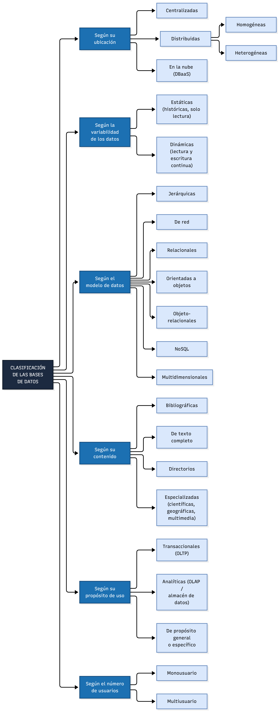
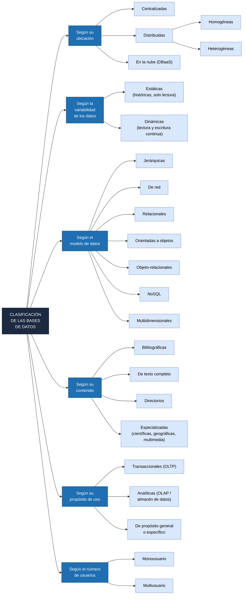

# Cuadro sinóptico: clasificación de las bases de datos

## Vista previa

**Fuente vectorial:** [`mbddSinoptico.svg`](mbddSinoptico.svg)

## Versión en Mermaid

GitHub muestra este diagrama directamente. Su código fuente está en [`CuadroSinoptico.mmd`](CuadroSinoptico.mmd).

## Descripción de los criterios

| Criterio | Categorías | Descripción |
|---|---|---|
| **Ubicación** | Centralizadas | Los datos residen en un solo sitio o servidor. |
| | Distribuidas (homogéneas / heterogéneas) | Los datos se reparten en varios sitios conectados por red. Son homogéneas si todos usan el mismo SGBD y heterogéneas si no. |
| | En la nube (DBaaS) | La base de datos se ofrece como servicio por un proveedor externo. |
| **Variabilidad de los datos** | Estáticas | Datos históricos de solo lectura, usados para consulta y análisis. |
| | Dinámicas | Los datos cambian de forma continua (altas, bajas y modificaciones). |
| **Modelo de datos** | Jerárquicas, de red, relacionales, orientadas a objetos, objeto-relacionales, NoSQL y multidimensionales | Según cómo se representan los datos (ver Tarea 1.1). |
| **Contenido** | Bibliográficas, texto completo, directorios y especializadas | Según el tipo de información que almacenan. |
| **Propósito de uso** | Transaccionales (OLTP) y analíticas (OLAP) | OLTP atiende las operaciones diarias; OLAP apoya el análisis y la toma de decisiones. |
| **Número de usuarios** | Monousuario y multiusuario | Si el sistema atiende a un usuario a la vez o a muchos de forma concurrente. |

> Un mismo sistema puede pertenecer a varias categorías a la vez (por ejemplo, relacional, dinámica, distribuida y transaccional).

## Referencias

Elmasri, R., & Navathe, S. B. (2016). *Fundamentals of database systems* (7.ª ed.). Pearson.

Özsu, M. T., & Valduriez, P. (2020). *Principles of distributed database systems* (4.ª ed.). Springer. https://doi.org/10.1007/978-3-030-26253-2

Silberschatz, A., Korth, H. F., & Sudarshan, S. (2010). *Database system concepts* (6.ª ed.). McGraw-Hill.
