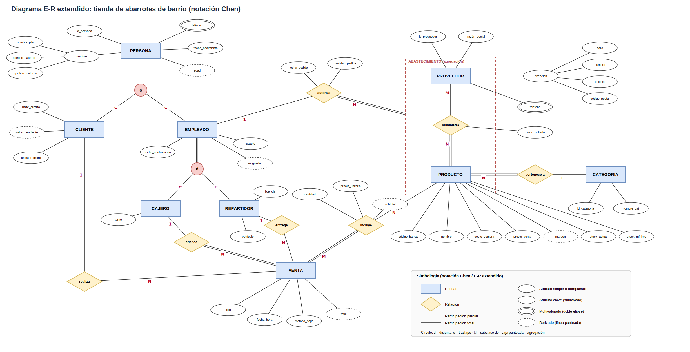

# Modelado conceptual E-R y E-R extendido: tienda de abarrotes de barrio

> Tarea 2.1, Unidad 2. Caso de estudio: negocio local (tienda de abarrotes).

## 1. Descripción contextual del caso

Se modela una **tienda de abarrotes de barrio** que vende productos de consumo diario (alimentos, bebidas, limpieza y papelería básica). El negocio atiende a clientes del vecindario, algunos de los cuales compran **a crédito (fiado)** hasta un límite acordado. Los productos se agrupan por categoría y se reabastecen con diferentes proveedores. La tienda cuenta con cajeros que atienden las ventas en mostrador y repartidores que llevan pedidos a domicilio.

**Problemática:** hoy el negocio lleva sus registros en una libreta, por lo que es difícil conocer el inventario real, el saldo que debe cada cliente y qué productos conviene reabastecer. Una base de datos permitiría controlar ventas, inventario, crédito y abastecimiento.

## 2. Reglas de negocio

| N.º | Regla de negocio |
|---|---|
| RN1 | Cada producto se identifica por su código de barras y pertenece a una sola categoría; una categoría agrupa muchos productos. |
| RN2 | Un producto puede ser surtido por varios proveedores y un proveedor surte varios productos; se registra el costo unitario de cada suministro. Todo producto debe tener al menos un proveedor. |
| RN3 | Toda venta tiene un folio único, fecha y hora, método de pago y la atiende exactamente un cajero. |
| RN4 | Una venta incluye uno o más productos; por cada uno se registra la cantidad y el precio unitario al momento de la venta. |
| RN5 | El total de una venta es la suma de los subtotales (cantidad × precio unitario). |
| RN6 | Una venta puede asociarse a un cliente registrado; las ventas al público general no requieren cliente. |
| RN7 | Un cliente puede comprar a crédito hasta su límite de crédito; su saldo pendiente se calcula con sus ventas a crédito no pagadas. |
| RN8 | Una venta puede tener entrega a domicilio a cargo de un repartidor; un repartidor puede entregar muchas ventas. |
| RN9 | Toda persona registrada puede ser cliente, empleado o ambos (por ejemplo, un empleado que también compra en la tienda). |
| RN10 | Todo empleado desempeña un puesto: cajero o repartidor, pero no ambos. |
| RN11 | Los pedidos de reabastecimiento a un proveedor sobre un producto los autoriza un empleado, quien puede autorizar muchos pedidos. |
| RN12 | Cuando el stock actual de un producto sea menor o igual a su stock mínimo, debe generarse un pedido de reabastecimiento. |
| RN13 | Una persona o proveedor puede tener varios teléfonos de contacto. |
| RN14 | El margen de un producto es la diferencia entre su precio de venta y su costo de compra. |

## 3. Entidades y atributos

| Entidad | Atributos | Tipo de atributo |
|---|---|---|
| **PERSONA** | <u>id_persona</u> | Clave |
| | nombre (nombre_pila, apellido_paterno, apellido_materno) | Compuesto |
| | teléfono | Multivalorado |
| | fecha_nacimiento | Simple |
| | edad | Derivado (de fecha_nacimiento) |
| **CLIENTE** (subclase de PERSONA) | limite_credito, fecha_registro | Simples |
| | saldo_pendiente | Derivado (de las ventas a crédito) |
| **EMPLEADO** (subclase de PERSONA) | fecha_contratación, salario | Simples |
| | antigüedad | Derivado (de fecha_contratación) |
| **CAJERO** (subclase de EMPLEADO) | turno | Simple |
| **REPARTIDOR** (subclase de EMPLEADO) | licencia, vehículo | Simples |
| **PRODUCTO** | <u>código_barras</u> | Clave |
| | nombre, costo_compra, precio_venta, stock_actual, stock_mínimo | Simples |
| | margen | Derivado (precio_venta − costo_compra) |
| **CATEGORIA** | <u>id_categoria</u>, nombre_cat | Clave y simple |
| **PROVEEDOR** | <u>id_proveedor</u> | Clave |
| | razón_social | Simple |
| | dirección (calle, número, colonia, código_postal) | Compuesto |
| | teléfono | Multivalorado |
| **VENTA** | <u>folio</u> | Clave |
| | fecha_hora, método_pago | Simples |
| | total | Derivado (suma de subtotales) |

## 4. Relaciones, cardinalidades y participación

| Relación | Entidades | Cardinalidad | Participación | Atributos de la relación |
|---|---|---|---|---|
| **realiza** | CLIENTE – VENTA | 1 : N | CLIENTE parcial, VENTA parcial | |
| **atiende** | CAJERO – VENTA | 1 : N | CAJERO parcial, VENTA **total** | |
| **entrega** | REPARTIDOR – VENTA | 1 : N | REPARTIDOR parcial, VENTA parcial | |
| **incluye** | VENTA – PRODUCTO | M : N | VENTA **total**, PRODUCTO parcial | cantidad, precio_unitario, subtotal (derivado) |
| **pertenece a** | PRODUCTO – CATEGORIA | N : 1 | PRODUCTO **total**, CATEGORIA parcial | |
| **suministra** | PROVEEDOR – PRODUCTO | M : N | PROVEEDOR parcial, PRODUCTO **total** | costo_unitario |
| **autoriza** | EMPLEADO – ABASTECIMIENTO | 1 : N | EMPLEADO parcial, ABASTECIMIENTO **total** | fecha_pedido, cantidad_pedida |

## 5. Conceptos del modelo E-R extendido aplicados

### 5.1 Especialización y generalización

- **PERSONA → {CLIENTE, EMPLEADO}:** especialización **parcial** y con **traslape (o)**. Una persona puede no ser ni cliente ni empleado, o ser ambos a la vez (RN9). Visto de abajo hacia arriba, CLIENTE y EMPLEADO se **generalizan** en PERSONA, porque comparten id, nombre, teléfono y fecha de nacimiento.
- **EMPLEADO → {CAJERO, REPARTIDOR}:** especialización **total** y **disjunta (d)**. Todo empleado es cajero o repartidor, pero no ambos (RN10).

### 5.2 Jerarquía

Las dos especializaciones forman una **jerarquía de dos niveles**: PERSONA → EMPLEADO → CAJERO / REPARTIDOR. Cada subclase **hereda** los atributos y las relaciones de su superclase; por ejemplo, un CAJERO hereda el nombre de PERSONA y el salario de EMPLEADO. Además, las subclases participan en relaciones propias: CAJERO en *atiende* y REPARTIDOR en *entrega*.

### 5.3 Agregación

La relación **suministra** (PROVEEDOR – PRODUCTO) se trata como una **entidad agregada** llamada **ABASTECIMIENTO**, porque otra relación debe asociarse con ella: un EMPLEADO **autoriza** cada abastecimiento (RN11). Sin la agregación no se podría relacionar al empleado con la combinación proveedor-producto como un todo.

## 6. Diagrama E-R extendido (notación Chen)

Archivos del diagrama:
- Vectorial: [`er-tienda-abarrotes.svg`](er-tienda-abarrotes.svg)
- Código Mermaid: [`er-tienda-abarrotes.mmd`](er-tienda-abarrotes.mmd)

### Simbología

| Símbolo | Significado |
|---|---|
| Rectángulo | Entidad |
| Rombo | Relación |
| Elipse | Atributo (subrayado si es clave) |
| Elipse doble | Atributo multivalorado |
| Elipse punteada | Atributo derivado |
| Línea doble | Participación total |
| Línea simple | Participación parcial |
| Círculo con **d** u **o** | Especialización disjunta u con traslape |
| ⊂ | Subclase de |
| Caja punteada | Agregación |

### Versión en Mermaid

En Mermaid se usa un `flowchart` para emular la notación Chen: rectángulos (entidades), rombos (relaciones), óvalos (atributos), doble círculo (multivalorado), líneas gruesas (participación total) y un `subgraph` (agregación). GitHub lo dibuja directamente.

```mermaid
flowchart TB
    subgraph AGG["ABASTECIMIENTO (agregación)"]
        PROVEEDOR["PROVEEDOR"]:::ent
        suministra{"suministra"}:::rel
        PRODUCTO["PRODUCTO"]:::ent
        PROVEEDOR ---|"M"| suministra
        suministra ===|"N"| PRODUCTO
    end
    PERSONA["PERSONA"]:::ent
    CLIENTE["CLIENTE"]:::ent
    EMPLEADO["EMPLEADO"]:::ent
    CAJERO["CAJERO"]:::ent
    REPARTIDOR["REPARTIDOR"]:::ent
    VENTA["VENTA"]:::ent
    CATEGORIA["CATEGORIA"]:::ent
    O(("o")):::circ
    D(("d")):::circ
    realiza{"realiza"}:::rel
    atiende{"atiende"}:::rel
    entrega{"entrega"}:::rel
    incluye{"incluye"}:::rel
    autoriza{"autoriza"}:::rel
    pertenece{"pertenece a"}:::rel
    a_PERSONA_id_persona(["<u>id_persona</u>"]):::attr
    a_PERSONA_nombre(["nombre"]):::attr
    a_PERSONA_telefono((("teléfono"))):::attr
    a_PERSONA_fecha_nacimiento(["fecha_nacimiento"]):::attr
    a_PERSONA_edad(["edad"]):::der
    a_nombre_pila(["nombre_pila"]):::attr
    a_ap_pat(["apellido_paterno"]):::attr
    a_ap_mat(["apellido_materno"]):::attr
    a_CLIENTE_limite_credito(["limite_credito"]):::attr
    a_CLIENTE_saldo_pendiente(["saldo_pendiente"]):::der
    a_CLIENTE_fecha_registro(["fecha_registro"]):::attr
    a_EMPLEADO_fecha_contratacion(["fecha_contratación"]):::attr
    a_EMPLEADO_salario(["salario"]):::attr
    a_EMPLEADO_antigüedad(["antigüedad"]):::der
    a_CAJERO_turno(["turno"]):::attr
    a_REPARTIDOR_licencia(["licencia"]):::attr
    a_REPARTIDOR_vehiculo(["vehículo"]):::attr
    a_VENTA_folio(["<u>folio</u>"]):::attr
    a_VENTA_fecha_hora(["fecha_hora"]):::attr
    a_VENTA_metodo_pago(["método_pago"]):::attr
    a_VENTA_total(["total"]):::der
    a_PRODUCTO_codigo_barras(["<u>código_barras</u>"]):::attr
    a_PRODUCTO_nombre(["nombre"]):::attr
    a_PRODUCTO_costo_compra(["costo_compra"]):::attr
    a_PRODUCTO_precio_venta(["precio_venta"]):::attr
    a_PRODUCTO_margen(["margen"]):::der
    a_PRODUCTO_stock_actual(["stock_actual"]):::attr
    a_PRODUCTO_stock_minimo(["stock_mínimo"]):::attr
    a_CATEGORIA_id_categoria(["<u>id_categoria</u>"]):::attr
    a_CATEGORIA_nombre_cat(["nombre_cat"]):::attr
    a_PROVEEDOR_id_proveedor(["<u>id_proveedor</u>"]):::attr
    a_PROVEEDOR_razon_social(["razón_social"]):::attr
    a_PROVEEDOR_direccion(["dirección"]):::attr
    a_PROVEEDOR_telefono_((("teléfono "))):::attr
    a_dir_calle(["calle"]):::attr
    a_dir_numero(["número"]):::attr
    a_dir_colonia(["colonia"]):::attr
    a_dir_codigo_postal(["código_postal"]):::attr
    a_incluye_cantidad(["cantidad"]):::attr
    a_incluye_precio_unitario(["precio_unitario"]):::attr
    a_incluye_subtotal(["subtotal"]):::der
    a_suministra_costo_unitario(["costo_unitario"]):::attr
    a_autoriza_fecha_pedido(["fecha_pedido"]):::attr
    a_autoriza_cantidad_pedida(["cantidad_pedida"]):::attr
    PERSONA --- a_PERSONA_id_persona
    PERSONA --- a_PERSONA_nombre
    PERSONA --- a_PERSONA_telefono
    PERSONA --- a_PERSONA_fecha_nacimiento
    PERSONA --- a_PERSONA_edad
    a_PERSONA_nombre --- a_nombre_pila
    a_PERSONA_nombre --- a_ap_pat
    a_PERSONA_nombre --- a_ap_mat
    CLIENTE --- a_CLIENTE_limite_credito
    CLIENTE --- a_CLIENTE_saldo_pendiente
    CLIENTE --- a_CLIENTE_fecha_registro
    EMPLEADO --- a_EMPLEADO_fecha_contratacion
    EMPLEADO --- a_EMPLEADO_salario
    EMPLEADO --- a_EMPLEADO_antigüedad
    CAJERO --- a_CAJERO_turno
    REPARTIDOR --- a_REPARTIDOR_licencia
    REPARTIDOR --- a_REPARTIDOR_vehiculo
    VENTA --- a_VENTA_folio
    VENTA --- a_VENTA_fecha_hora
    VENTA --- a_VENTA_metodo_pago
    VENTA --- a_VENTA_total
    PRODUCTO --- a_PRODUCTO_codigo_barras
    PRODUCTO --- a_PRODUCTO_nombre
    PRODUCTO --- a_PRODUCTO_costo_compra
    PRODUCTO --- a_PRODUCTO_precio_venta
    PRODUCTO --- a_PRODUCTO_margen
    PRODUCTO --- a_PRODUCTO_stock_actual
    PRODUCTO --- a_PRODUCTO_stock_minimo
    CATEGORIA --- a_CATEGORIA_id_categoria
    CATEGORIA --- a_CATEGORIA_nombre_cat
    PROVEEDOR --- a_PROVEEDOR_id_proveedor
    PROVEEDOR --- a_PROVEEDOR_razon_social
    PROVEEDOR --- a_PROVEEDOR_direccion
    PROVEEDOR --- a_PROVEEDOR_telefono_
    a_PROVEEDOR_direccion --- a_dir_calle
    a_PROVEEDOR_direccion --- a_dir_numero
    a_PROVEEDOR_direccion --- a_dir_colonia
    a_PROVEEDOR_direccion --- a_dir_codigo_postal
    incluye --- a_incluye_cantidad
    incluye --- a_incluye_precio_unitario
    incluye --- a_incluye_subtotal
    suministra --- a_suministra_costo_unitario
    autoriza --- a_autoriza_fecha_pedido
    autoriza --- a_autoriza_cantidad_pedida
    O ---|"⊂"| CLIENTE
    O ---|"⊂"| EMPLEADO
    EMPLEADO === D
    D ---|"⊂"| CAJERO
    D ---|"⊂"| REPARTIDOR
    CLIENTE ---|"1"| realiza
    realiza ---|"N"| VENTA
    CAJERO ---|"1"| atiende
    atiende ===|"N"| VENTA
    REPARTIDOR ---|"1"| entrega
    entrega ---|"N"| VENTA
    VENTA ===|"M"| incluye
    incluye ---|"N"| PRODUCTO
    EMPLEADO ---|"1"| autoriza
    autoriza ===|"N"| AGG
    PRODUCTO ===|"N"| pertenece
    pertenece ---|"1"| CATEGORIA
    PERSONA --- O
    classDef ent fill:#DAE8FC,stroke:#6C8EBF,stroke-width:2px,color:#000,font-weight:bold
    classDef rel fill:#FFF2CC,stroke:#D6B656,stroke-width:2px,color:#000
    classDef attr fill:#fff,stroke:#444,color:#000
    classDef der fill:#fff,stroke:#444,stroke-dasharray:5 4,color:#000
    classDef circ fill:#F8CECC,stroke:#B85450,stroke-width:2px,color:#000
```

## Referencias

Chen, P. P.-S. (1976). The entity-relationship model: Toward a unified view of data. *ACM Transactions on Database Systems, 1*(1), 9-36. https://doi.org/10.1145/320434.320440

Elmasri, R., & Navathe, S. B. (2016). *Fundamentals of database systems* (7.ª ed.). Pearson.

Silberschatz, A., Korth, H. F., & Sudarshan, S. (2010). *Database system concepts* (6.ª ed.). McGraw-Hill.
