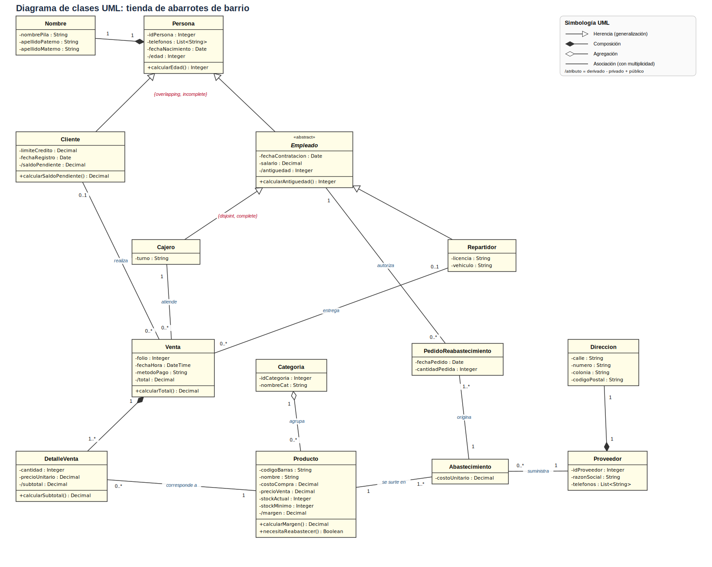
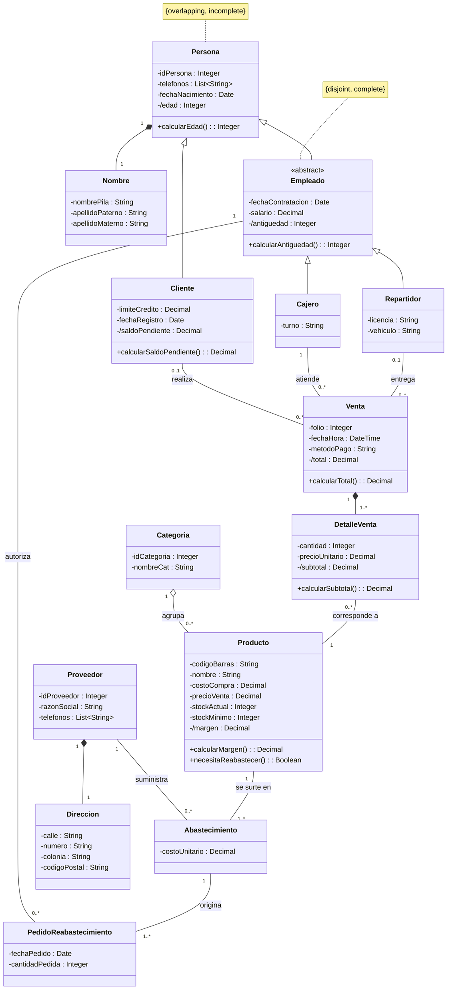

# Transición del diagrama E-R a notación UML: tienda de abarrotes de barrio

> Tarea 2.2, Unidad 2. Se convierte el diagrama E-R extendido de la [Tarea 2.1](../Tarea2.1/modelo-er-tienda.md) a un diagrama de clases UML y se compara una notación con la otra.

## 1. Diagrama de clases UML

Archivos del diagrama:
- Fuente editable en draw.io: [`uml-tienda-abarrotes.drawio`](uml-tienda-abarrotes.drawio)
- Vectorial: [`uml-tienda-abarrotes.svg`](uml-tienda-abarrotes.svg)
- Código Mermaid: [`uml-tienda-abarrotes.mmd`](uml-tienda-abarrotes.mmd)

En la versión Mermaid, `classDiagram` soporta clases, atributos, métodos, herencia, composición, agregación y multiplicidades. GitHub lo dibuja directamente:

## 2. Comparativa general: E-R vs. UML

| Concepto E-R | Notación E-R (Chen) | Equivalente en UML | Observaciones |
|---|---|---|---|
| Entidad | Rectángulo | **Clase** | Correspondencia directa. La clase agrega comportamiento (métodos) y visibilidad. |
| Atributo simple | Elipse | **Atributo** (propiedad) con tipo y visibilidad | UML exige indicar el tipo de dato (`String`, `Integer`, `Decimal`...). |
| Atributo clave | Elipse subrayada | Atributo identificador (`idPersona`, `folio`...) | UML no tiene el concepto de clave; el identificador es una convención (o la restricción `{id}`). |
| Atributo compuesto | Elipse con sub-elipses | **Clase** relacionada por **composición**, o tipo estructurado | Ejemplo: `nombre` → clase `Nombre`; `dirección` → clase `Direccion`. |
| Atributo multivalorado | Elipse doble | Atributo con multiplicidad `1..*` (por ejemplo `List<String>`) | En el modelo relacional pasaría a ser otra tabla; en objetos es una colección. |
| Atributo derivado | Elipse punteada | **Atributo derivado** (`/edad`) y/o **método** (`calcularEdad()`) | El derivado se marca con `/`. En código suele implementarse como método. |
| Relación | Rombo | **Asociación** | Se nombra con verbo y se le puede dar navegabilidad. |
| Cardinalidad (1:1, 1:N, M:N) | Etiquetas 1, N, M | **Multiplicidad** (`1`, `0..1`, `0..*`, `1..*`) | UML indica mínimo y máximo en cada extremo. |
| Participación total / parcial | Línea doble / simple | **Multiplicidad mínima** (`1` = total, `0` = parcial) | UML la integra a la multiplicidad. |
| Relación M:N o con atributos | Rombo con elipses | **Clase de asociación** o clase intermedia | Ejemplo: `incluye` → `DetalleVenta`; `suministra` → `Abastecimiento`. |
| Entidad débil | Rectángulo doble | Clase en **composición** con su dueña | Ejemplo: `DetalleVenta` no existe sin `Venta`. |
| Especialización / generalización | Círculo `d` / `o` con ⊂ | **Herencia** (generalización) con conjuntos de generalización | `{disjoint}`, `{overlapping}`, `{complete}`, `{incomplete}`. |
| Jerarquía | Cadena de especializaciones | **Jerarquía de clases** | Las subclases heredan atributos y relaciones. |
| Agregación E-R | Relación tratada como entidad | **Clase** (de asociación) | **No es lo mismo** que la agregación de UML (ver sección 5). |
| *(No existe)* | | **Métodos / operaciones** | El E-R modela datos; UML también modela comportamiento. |
| *(No existe)* | | **Visibilidad, navegabilidad, estereotipos** | Detalles para el diseño orientado a objetos. |

## 3. Correspondencia aplicada al caso de la tienda

### 3.1 Entidades → clases

| Entidad E-R | Clase UML | Nota |
|---|---|---|
| PERSONA | `Persona` | Superclase con `idPersona`, `telefonos`, `fechaNacimiento` y `/edad` |
| CLIENTE | `Cliente` | Subclase de `Persona` |
| EMPLEADO | `Empleado` | Subclase de `Persona`; **abstracta**, porque la especialización es total |
| CAJERO | `Cajero` | Subclase de `Empleado` |
| REPARTIDOR | `Repartidor` | Subclase de `Empleado` |
| VENTA | `Venta` | |
| PRODUCTO | `Producto` | |
| CATEGORIA | `Categoria` | |
| PROVEEDOR | `Proveedor` | |

### 3.2 Atributos → propiedades

| Tipo en E-R | Atributo E-R | Propiedad UML |
|---|---|---|
| Clave | id_persona, folio, código_barras, id_categoria, id_proveedor | `-idPersona : Integer`, `-folio : Integer`, `-codigoBarras : String`, `-idCategoria : Integer`, `-idProveedor : Integer` |
| Compuesto | nombre (nombre_pila, apellido_paterno, apellido_materno) | Clase `Nombre` en composición con `Persona` |
| Compuesto | dirección (calle, número, colonia, código_postal) | Clase `Direccion` en composición con `Proveedor` |
| Multivalorado | teléfono (PERSONA y PROVEEDOR) | `-telefonos : List<String>` |
| Derivado | edad | `-/edad : Integer` y `+calcularEdad()` |
| Derivado | antigüedad | `-/antiguedad : Integer` y `+calcularAntiguedad()` |
| Derivado | saldo_pendiente | `-/saldoPendiente : Decimal` y `+calcularSaldoPendiente()` |
| Derivado | total | `-/total : Decimal` y `+calcularTotal()` |
| Derivado | subtotal | `-/subtotal : Decimal` y `+calcularSubtotal()` |
| Derivado | margen | `-/margen : Decimal` y `+calcularMargen()` |
| Simples | resto de atributos | Atributos privados con su tipo (`-salario : Decimal`, `-turno : String`...) |

### 3.3 Relaciones → asociaciones

| Relación E-R | Cardinalidad y participación | Elemento UML | Multiplicidad |
|---|---|---|---|
| realiza (CLIENTE–VENTA) | 1:N, ambas parciales | Asociación `Cliente` – `Venta` | `0..1` – `0..*` |
| atiende (CAJERO–VENTA) | 1:N, VENTA total | Asociación `Cajero` – `Venta` | `1` – `0..*` |
| entrega (REPARTIDOR–VENTA) | 1:N, ambas parciales | Asociación `Repartidor` – `Venta` | `0..1` – `0..*` |
| incluye (VENTA–PRODUCTO) | M:N con atributos, VENTA total | Clase `DetalleVenta`: **composición** `Venta` ◆ `1..*` `DetalleVenta` y asociación `DetalleVenta` `0..*` – `1` `Producto` | `1` – `1..*` y `0..*` – `1` |
| pertenece a (PRODUCTO–CATEGORIA) | N:1, PRODUCTO total | **Agregación** `Categoria` ◇ `Producto` | `1` – `0..*` |
| suministra + agregación ABASTECIMIENTO | M:N con atributo, PRODUCTO total | Clase `Abastecimiento` con asociaciones a `Proveedor` y `Producto` | `Proveedor` `1` – `0..*`; `Producto` `1` – `1..*` |
| autoriza (EMPLEADO–ABASTECIMIENTO) | 1:N con atributos, ABASTECIMIENTO total | Clase `PedidoReabastecimiento` con asociaciones a `Empleado` y `Abastecimiento` | `Empleado` `1` – `0..*`; `Abastecimiento` `1` – `1..*` |

### 3.4 Especialización, generalización y herencia

| Concepto E-R | En UML |
|---|---|
| PERSONA → {CLIENTE, EMPLEADO}, parcial y con traslape (`o`) | Herencia `Cliente` y `Empleado` hacia `Persona`, con la restricción `{overlapping, incomplete}` |
| EMPLEADO → {CAJERO, REPARTIDOR}, total y disjunta (`d`) | Herencia `Cajero` y `Repartidor` hacia `Empleado` (abstracta), con la restricción `{disjoint, complete}` |
| Jerarquía de dos niveles | `Persona` ← `Empleado` ← `Cajero` / `Repartidor` |

### 3.5 Composición, agregación y herencia en el diagrama

| Tipo | Dónde aparece | Por qué |
|---|---|---|
| **Composición** (rombo negro) | `Persona` ◆ `Nombre`; `Proveedor` ◆ `Direccion`; `Venta` ◆ `DetalleVenta` | La parte no existe sin el todo: un detalle no existe sin su venta. |
| **Agregación** (rombo blanco) | `Categoria` ◇ `Producto` | La categoría agrupa productos, pero un producto puede existir independientemente de ella. |
| **Herencia** (triángulo blanco) | `Cliente`, `Empleado` → `Persona`; `Cajero`, `Repartidor` → `Empleado` | Relación «es un»: un cajero es un empleado, y un empleado es una persona. |

## 4. Análisis de coincidencias para el desarrollo orientado a objetos

**Coincidencias directas.** Las entidades se convierten en clases, los atributos en propiedades, las relaciones en asociaciones, la cardinalidad en multiplicidad y la especialización en herencia. Por eso el modelo conceptual E-R sirve como base del modelo de clases sin rehacer el análisis.

**Lo que UML añade.**
- **Comportamiento:** los atributos derivados se convierten en métodos, y las reglas de negocio pasan a ser operaciones. Por ejemplo, la regla RN12 se implementa en `Producto.necesitaReabastecer()`.
- **Tipos y visibilidad:** cada atributo tiene tipo y es privado, accesible mediante métodos.
- **Semántica todo-parte:** UML distingue composición, agregación y asociación simple; el E-R no.

**Lo que se debe decidir al programar.**
1. **Herencia con traslape.** Una persona puede ser cliente y empleado a la vez (RN9). La mayoría de los lenguajes orientados a objetos no permite que un objeto sea de dos subclases a la vez. La alternativa es modelar los roles por **composición**: `Persona` tiene un rol de `Cliente` y/o de `Empleado`.
2. **Claves e identidad.** En UML no existen claves primarias ni foráneas; los objetos se relacionan por referencias. Al guardar en una base relacional, un ORM traduce los identificadores y las asociaciones a claves.
3. **Relaciones M:N.** Se resuelven con clases intermedias (`DetalleVenta`, `Abastecimiento`), igual que en el modelo relacional con tablas intermedias.
4. **Atributos multivalorados.** Se convierten en colecciones (`List<String>`), no en tablas aparte.
5. **Restricciones no representables.** Reglas como «el crédito no puede exceder el límite» o «generar pedido al llegar al stock mínimo» se programan como lógica de negocio, no se dibujan.

## 5. Diferencia importante: «agregación» en E-R extendido y en UML

Aunque comparten el nombre, son conceptos distintos:

| | Agregación en E-R extendido | Agregación en UML |
|---|---|---|
| Significado | Tratar una **relación** como una entidad para relacionarla con otra | Relación «todo-parte» entre dos clases |
| Ejemplo en el caso | `suministra` (Proveedor–Producto) se vuelve ABASTECIMIENTO, que un empleado autoriza | `Categoria` agrupa `Producto` |
| Cómo se traduce | Como **clase** (`Abastecimiento`) con asociaciones | Como **rombo blanco** (`Categoria` ◇ `Producto`) |

## Referencias

Chen, P. P.-S. (1976). The entity-relationship model: Toward a unified view of data. *ACM Transactions on Database Systems, 1*(1), 9-36. https://doi.org/10.1145/320434.320440

Elmasri, R., & Navathe, S. B. (2016). *Fundamentals of database systems* (7.ª ed.). Pearson.

Fowler, M. (2004). *UML distilled: A brief guide to the standard object modeling language* (3.ª ed.). Addison-Wesley.

Object Management Group. (2017). *Unified Modeling Language (UML) specification, version 2.5.1*. https://www.omg.org/spec/UML/2.5.1
