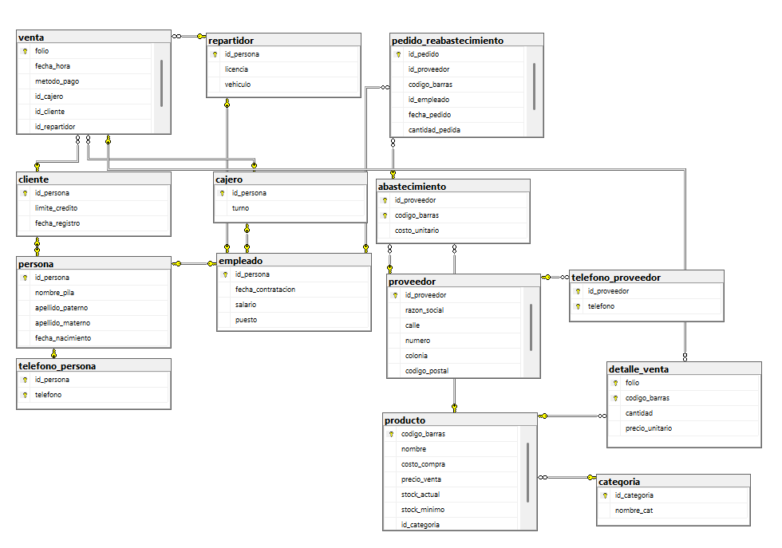

# Tarea 3.2: Generación del esquema físico en SGBD y script LDD

📍 [Fundamentos de Bases de Datos](../../README.md) › [Unidad 3](../README.md) › **Tarea 3.2**
&nbsp;&nbsp;|&nbsp;&nbsp; ⬅️ [Ir a la Tarea 3.1](../Tarea3.1BDD/README.md)

**Tecnológico Nacional de México**
**Carrera:** Ingeniería Informática
**Materia:** Fundamentos de Base de Datos
**Unidad:** 3
**Alumna:** Gabriela Natalia De León Alvarez
**Matrícula:** I24050006

---

## 📌 Descripción

Implementación en **Microsoft SQL Server** del esquema relacional de la tienda de abarrotes (Tarea 3.1):

- Script LDD `schema.sql` con `CREATE TABLE`, `PRIMARY KEY`, `FOREIGN KEY` (con `ON DELETE` y `ON UPDATE`), `CHECK`, `NOT NULL`, `UNIQUE`, `DEFAULT`, índices y vistas.
- Diccionario de datos, diagrama del esquema físico y evidencias de ejecución.

## 🎥 Video de la demostración

▶️ **[Ver video en YouTube](PEGA-AQUI-EL-ENLACE-DEL-VIDEO)**

Ejecución del script en SQL Server, con la creación limpia de las tablas y las llaves foráneas y la validación del esquema, con cámara web en la esquina inferior derecha.

## 📂 Contenido de la carpeta

| Archivo | Descripción |
|---|---|
| [schema.sql](schema.sql) | **Script LDD principal** (re-ejecutable) |
| [validacion.sql](validacion.sql) | Consultas al catálogo para validar el esquema |
| [datos-prueba.sql](datos-prueba.sql) | Datos de ejemplo y pruebas de restricciones |
| [reporte-esquema-fisico.md](reporte-esquema-fisico.md) | Reporte con diccionario de datos y evidencias |
| [Tarea3.2.pdf](Tarea3.2.pdf) | Reporte técnico en PDF |
| [EsquemaSQL.png](EsquemaSQL.png) | Esquema de la base de datos en SQLMMS |

## ▶️ Cómo ejecutarlo

1. Abrir **SQL Server Management Studio** y conectarse a la instancia.
2. Ejecutar `schema.sql` completo (crea la base `TiendaAbarrotes`).
3. Ejecutar `validacion.sql` para comprobar el esquema.
4. Ejecutar `datos-prueba.sql` para cargar datos y probar las restricciones.

Requiere SQL Server 2016 SP1 o superior.

## 🗺️ Vista previa del esquema físico

## 🛠️ Herramientas utilizadas

- Microsoft SQL Server y SQL Server Management Studio (SSMS)
- draw.io y Mermaid para el diagrama de referencia
- GitHub para el alojamiento

## 📚 Referencias (APA 7)

Date, C. J. (2004). *An introduction to database systems* (8.ª ed.). Pearson/Addison-Wesley.

Elmasri, R., & Navathe, S. B. (2016). *Fundamentals of database systems* (7.ª ed.). Pearson.

Microsoft. (s. f.). *CREATE TABLE (Transact-SQL)*. Microsoft Learn. Recuperado el 30 de octubre de 2026, de https://learn.microsoft.com/en-us/sql/t-sql/statements/create-table-transact-sql

Microsoft. (s. f.). *Primary and foreign key constraints*. Microsoft Learn. Recuperado el 30 de octubre de 2026, de https://learn.microsoft.com/en-us/sql/relational-databases/tables/primary-and-foreign-key-constraints

Silberschatz, A., Korth, H. F., & Sudarshan, S. (2010). *Database system concepts* (6.ª ed.). McGraw-Hill.
