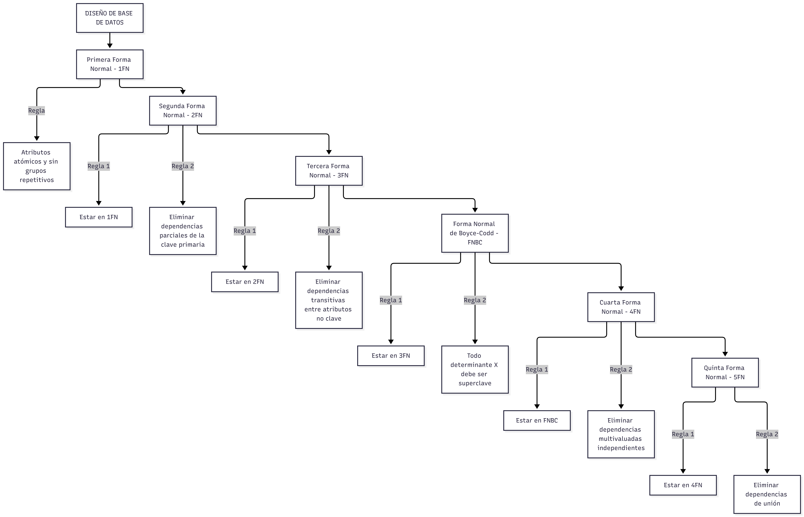

# Tarea 4.1: Normalización de Bases de Datos (Formas Normales y Anomalías)

**Tecnológico Nacional de México**  
**Carrera:** Ingeniería Informática  
**Materia:** Fundamentos de Base de Datos  
**Unidad:** 4  
**Alumna:** Gabriela Natalia De León Alvarez  
**Matrícula:** I24050006  

---

## 📌 Descripción

Esta carpeta contiene la documentación, esquemas y diagramas correspondientes a la **Tarea 4.1**, desarrollada con base en los fundamentos de diseño y normalización de bases de datos relacionales:

1. **Conceptos Fundamentales de Normalización y Dependencias:**  
   Investigación y análisis formal de los conceptos clave para estructurar bases de datos relacionales eficientes:
   - **Concepto formal de normalización:** Proceso para minimizar la redundancia de datos y prevenir anomalías estructurales.
   - **Dependencias funcionales:** Análisis de dependencias funcionales completas y parciales respecto a las claves primarias.
   - **Dependencias transitivas:** Identificación de relaciones indirectas entre atributos no clave.
   - **Anomalías clásicas:** Estudio detallado de las fallas operativas por falta de normalización (anomalías de inserción, borrado y modificación).

2. **Mapa Conceptual de Reglas y Formas Normales:**  
   Esquematización jerárquica de la progresión de formas normales para asegurar la integridad de los datos:
   - **Primera Forma Normal (1FN):** Atributos atómicos y eliminación de grupos repetitivos.
   - **Segunda Forma Normal (2FN):** Cumplimiento de 1FN y eliminación de dependencias parciales.
   - **Tercera Forma Normal (3FN):** Cumplimiento de 2FN y eliminación de dependencias transitivas.
   - **Forma Normal de Boyce-Codd (FNBC):** Restricción estricta donde todo determinante debe ser una superclave.
   - **Cuarta y Quinta Forma Normal (4FN / 5FN):** Eliminación de dependencias multivaluadas y de unión.

---

## 🎥 Video explicativo

▶️ **[Ver video en YouTube](PEGA-AQUI-EL-ENLACE-DEL-VIDEO)**

El video detalla los conceptos de dependencias funcionales, las anomalías clásicas en bases de datos y la explicación paso a paso del mapa conceptual de las formas normales (de 1FN a 5FN).

---

## 📂 Contenido de la carpeta

| Archivo | Descripción |
|---|---|
| [Tarea4.1.pdf](Tarea4.1.pdf) | Documento formal con portada institucional, marco teórico, análisis de dependencias, mapa conceptual y referencias APA |
| [mapa-normalizacion.md](mapa-normalizacion.md) | Documento en Markdown que describe el mapa conceptual y las reglas de normalización |
| [DiagramaNormalizacion.png](DiagramaNormalizacion.png) | Diagrama conceptual de las formas normales |

---

## 🗺️ Vistas previas de los diagramas

### 1. Mapa conceptual: Reglas y formas normales en el diseño de bases de datos

---

## 🛠️ Herramientas utilizadas

- [Mermaid.js](https://mermaid.js.org/) para modelado y visualización nativa de diagramas
- Microsoft Word / PDF para el documento académico formal
- OBS Studio para la grabación del video explicativo
- Git y GitHub para control de versiones y repositorio de evidencias

---

## 📚 Referencias (APA 7)

Elmasri, R., & Navathe, S. B. (2016). *Fundamentals of Database Systems* (7th ed.). Pearson.

Ramakrishnan, R., & Gehrke, J. (2003). *Database Management Systems* (3rd ed.). McGraw-Hill.

Silberschatz, A., Korth, H. F., & Sudarshan, S. (2020). *Database System Concepts* (7th ed.). McGraw-Hill Education.

Connolly, T. M., & Begg, C. E. (2015). *Database Systems: A Practical Approach to Design, Implementation, and Management* (6th ed.). Pearson.