# Tarea 4.2: Normalización de Bases de Datos (De 0FN a 3FN/FNBC y Script SQL)

📍 [Fundamentos de Bases de Datos](../../README.md) › [Unidad 4](../../README.md#unidad-4) › **Tarea 4.2**

**Tecnológico Nacional de México**  
**Carrera:** Ingeniería Informática  
**Materia:** Fundamentos de Base de Datos  
**Unidad:** 4  
**Alumna:** Gabriela Natalia De León Alvarez  
**Matrícula:** I24050006  

---

## 📌 Descripción

Esta carpeta contiene la documentación formal, el análisis matemático de dependencias funcionales y el script SQL correspondiente a la **Tarea 4.2**, donde se toma una estructura real desnormalizada del proyecto de la **tienda de abarrotes de barrio** y se transforma paso a paso hasta alcanzar el estado totalmente normalizado:

1. **De Estado Desnormalizado (0FN) a Primera Forma Normal (1FN):**
   - Eliminación de grupos repetitivos anidados (líneas de detalle de tickets de venta).
   - Conversión de atributos compuestos en atómicos (`nombre_pila`, `apellido_paterno`, `apellido_materno`, componentes de dirección).
   - Extracción de atributos multivalorados (múltiples teléfonos por persona).
   - Supresión de atributos calculados redundantes (`subtotal` y `total_venta`).
   - Definición formal de la clave primaria compuesta $\{\text{Folio\_Venta}, \text{Codigo\_Barras}\}$.

2. **De 1FN a Segunda Forma Normal (2FN):**
   - Identificación y análisis de dependencias funcionales parciales sobre subconjuntos de la clave compuesta.
   - Desacoplamiento de las entidades `VENTA`, `PRODUCTO` y `DETALLE_VENTA` para asegurar que todo atributo no primo posea dependencia funcional completa de su clave.

3. **De 2FN a Tercera Forma Normal (3FN) y Validación de FNBC:**
   - Detección y eliminación de dependencias transitivas:
     - En productos: $\text{Codigo\_Barras} \to \text{ID\_Categoria} \to \text{Nombre\_Categoria}$.
     - En ventas: $\text{Folio} \to \text{ID\_Persona} \to \text{Datos personales y contractuales}$.
   - Especialización y generalización de entidades (`PERSONA`, `CLIENTE`, `EMPLEADO`, `CAJERO`, `REPARTIDOR`).
   - Auditoría rigurosa de la **Forma Normal de Boyce-Codd (FNBC)**, verificando que todo determinante de una dependencia funcional sea una superclave.

4. **Script SQL Corregido (T-SQL / SQL Server):**
   - Implementación física en SQL Server del esquema normalizado resultante, con restricciones de clave, integridad referencial en cascada/no acción, restricciones `CHECK`, índices no agrupados, vistas para atributos derivados y datos de prueba.

---

## 📂 Contenido de la carpeta

| Archivo | Descripción |
|---|---|
| [transicion-normalizacion.md](transicion-normalizacion.md) | Documento analítico con la justificación formal paso a paso, análisis de dependencias $X \to Y$, tablas comparativas y diagrama Mermaid |
| [schema_normalizado.sql](schema_normalizado.sql) | Script DDL/DML en SQL Server del esquema completamente normalizado en 3FN/FNBC, con vistas calculadas y validación |
| [Tarea4.2.pdf](Tarea4.2.pdf) | Documento formal con portada institucional, análisis de dependencias, y referencias APA |

---

## 🗺️ Diagrama del Flujo de Normalización

```mermaid
flowchart LR
    A["0FN<br/>Tabla Universal Desnormalizada"] -->|"1FN: Atomicidad y sin repetición"| B["1FN<br/>PK Compuesta {Folio, Código}"]
    B -->|"2FN: Sin dependencias parciales"| C["2FN<br/>Venta, Detalle, Producto"]
    C -->|"3FN / FNBC: Sin dependencias transitivas"| D["3FN / FNBC<br/>Esquema Relacional Óptimo"]

    classDef c1 fill:#f8d7da,stroke:#dc3545,stroke-width:1px,color:#721c24;
    classDef c2 fill:#fff3cd,stroke:#ffc107,stroke-width:1px,color:#856404;
    classDef c3 fill:#d1ecf1,stroke:#17a2b8,stroke-width:1px,color:#0c5460;
    classDef c4 fill:#d4edda,stroke:#28a745,stroke-width:1px,color:#155724;

    class A c1;
    class B c2;
    class C c3;
    class D c4;
```

---

## 🛠️ Herramientas utilizadas

- **Modelado y Documentación:** Markdown, Mermaid.js
- **Motor de Base de Datos:** Microsoft SQL Server (T-SQL)
- **Control de Versiones:** Git y GitHub

---

## 📚 Referencias (APA 7)

Codd, E. F. (1970). A relational model of data for large shared data banks. *Communications of the ACM, 13*(6), 377–387. https://doi.org/10.1145/362384.362685

Codd, E. F. (1974). Recent investigations in relational data base systems. *Information Processing 74*, 1017–1021.

Connolly, T. M., & Begg, C. E. (2015). *Database systems: A practical approach to design, implementation, and management* (6.ª ed.). Pearson.

Elmasri, R., & Navathe, S. B. (2016). *Fundamentals of database systems* (7.ª ed.). Pearson.

Silberschatz, A., Korth, H. F., & Sudarshan, S. (2020). *Database system concepts* (7.ª ed.). McGraw-Hill Education.

