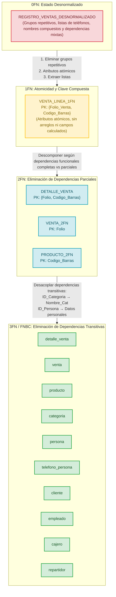

# Proceso de Normalización Paso a Paso: Tienda de Abarrotes de Barrio

📍 [Fundamentos de Bases de Datos](../../README.md) › [Unidad 4](../../README.md#unidad-4) › [Tarea 4.2](README.md) › **Transición de Normalización**

**Tecnológico Nacional de México**  
**Carrera:** Ingeniería Informática  
**Materia:** Fundamentos de Base de Datos  
**Unidad:** 4 — Normalización de Bases de Datos Relacionales  
**Alumna:** Gabriela Natalia De León Alvarez  
**Matrícula:** I24050006  

---

## 📌 1. Introducción y Contexto del Problema

En el proyecto de la **tienda de abarrotes de barrio**, las operaciones comerciales diarias se registraban originalmente mediante formatos planos o libretas de mostrador (hojas de cálculo o notas de venta manuales). En este tipo de registros sin normalizar, se vuelcan en una única estructura universal tanto los datos del comprobante de venta, los datos del cliente que compra al contado o a crédito, la información del cajero que atiende, el chofer repartidor para entregas a domicilio, y el listado de productos adquiridos con sus respectivas categorías y precios.

Esta estructura desnormalizada genera severas **anomalías de inserción, actualización y borrado**, además de una **redundancia descontrolada** e inconsistencias en la información.

A continuación, se documenta paso a paso la descomposición matemática y lógica de esta estructura, partiendo de la **Forma No Normalizada (0FN)** hasta la **Tercera Forma Normal (3FN)** y la validación en la **Forma Normal de Boyce-Codd (FNBC)**.

---

## 📋 2. Estado Desnormalizado (Forma No Normalizada - 0FN)

### 2.1 Estructura de la Tabla Universal Desnormalizada

Consideremos la relación unificada representativa del registro de venta y despacho:

$$\text{REGISTRO\_VENTAS\_DESNORMALIZADO}$$

$$\begin{aligned}
(& \underline{\text{Folio\_Venta}}, \text{Fecha\_Hora}, \text{Metodo\_Pago}, \\
& \text{Cliente\_Nombre\_Completo}, \text{Cliente\_Telefonos}, \text{Cliente\_Direccion}, \text{Limite\_Credito}, \\
& \text{ID\_Cajero}, \text{Cajero\_Nombre\_Completo}, \text{Turno\_Cajero}, \text{Salario\_Cajero}, \\
& \text{ID\_Repartidor}, \text{Repartidor\_Nombre\_Completo}, \text{Licencia\_Repartidor}, \text{Vehiculo\_Repartidor}, \\
& \{\text{Codigo\_Barras}, \text{Nombre\_Producto}, \text{ID\_Categoria}, \text{Nombre\_Categoria}, \text{Costo\_Compra}, \text{Precio\_Venta\_Catalogo}, \text{Cantidad}, \text{Precio\_Unitario\_Venta}, \text{Subtotal}\}, \\
& \text{Total\_Venta} )
\end{aligned}$$

### 2.2 Ejemplo de Datos en Estado Desnormalizado

| Folio | Fecha/Hora | Pago | Cliente_Nombre_Completo | Cliente_Telefonos | Cliente_Direccion | Lim_Cred | ID_Caj | Cajero_Nombre | Turno | ID_Rep | Repartidor_Nombre | Licencia | Vehiculo | Líneas de Detalle {Código, Nombre, Cat, Costo, P.Venta, Cant, P.Unit, Subtotal} | Total |
| :---: | :---: | :---: | :---: | :---: | :---: | :---: | :---: | :---: | :---: | :---: | :---: | :---: | :---: | :--- | :---: |
| 1001 | 2026-10-30 09:15 | EFECTIVO | Juan Carlos Pérez López | 5512345678, 5587654321 | Av. Hidalgo #45, Col. Centro, CP 01000 | 1500.00 | 1 | Mario Casas Cruz | MATUTINO | NULL | NULL | NULL | NULL | {PROD01, Leche Entera 1L, Lácteos, 18.00, 24.50, 2, 24.50, 49.00},  {PROD02, Pan Integral, Abarrotes, 22.00, 32.00, 1, 32.00, 32.00} | 81.00 |
| 1002 | 2026-10-30 10:30 | CREDITO | Ana Luisa Silva Romero | 5544332211 | Calle Morelos #12, Col. Juárez, CP 06600 | 2000.00 | 1 | Mario Casas Cruz | MATUTINO | 2 | Roberto Gómez Luna | LIC-CDMX-99 | Motocicleta Honda 125 | {PROD01, Leche Entera 1L, Lácteos, 18.00, 24.50, 4, 24.50, 98.00} | 98.00 |
| 1003 | 2026-10-30 16:45 | TARJETA | NULL (Venta mostrador público) | NULL | NULL | 0.00 | 3 | Laura Elena Méndez Silva | VESPERTINO | NULL | NULL | NULL | NULL | {PROD03, Frijol Negro 1kg, Granos, 28.00, 38.00, 2, 38.00, 76.00} | 76.00 |

### 2.3 Diagnóstico de Deficiencias y Anomalías en 0FN

1. **Grupos Repetitivos:** El conjunto de renglones de venta de productos es una colección anidada por cada folio de venta.
2. **Atributos No Atómicos (Compuestos):**
   - `Cliente_Nombre_Completo`, `Cajero_Nombre_Completo`, `Repartidor_Nombre_Completo`: combinan nombre de pila, apellido paterno y apellido materno en un solo valor textual.
   - `Cliente_Direccion`: combina calle, número exterior, colonia y código postal en una sola cadena.
3. **Atributos Multivalorados:**
   - `Cliente_Telefonos`: contiene múltiples números de teléfono separados por comas dentro de una misma celda.
4. **Atributos Derivados / Calculados Redundantes:**
   - `Subtotal` ($Cantidad \times Precio\_Unitario\_Venta$) y `Total_Venta` ($\sum Subtotal$). Generan riesgo de desincronización si cambian las cantidades.
5. **Anomalías Operativas Críticas:**
   - **Anomalía de Inserción:** No se puede dar de alta un producto nuevo en el catálogo ni una nueva categoría sin registrar forzosamente una venta simulada.
   - **Anomalía de Borrado:** Si se cancela o elimina el folio 1003, se pierde por completo del sistema la existencia del producto `PROD03` y de la categoría `Granos` si no existen otras ventas asociadas.
   - **Anomalía de Modificación:** Si el cajero Mario Casas cambia de turno o salario, debe actualizarse en cientos o miles de registros históricos de ventas; si alguno se omite, la base queda en estado inconsistente.

---

## 🔨 3. De Estado Desnormalizado a Primera Forma Normal (1FN)

### 3.1 Reglas para alcanzar la 1FN
Una relación se encuentra en **Primera Forma Normal (1FN)** si y solo si:
1. **Atomicidad:** Todos los valores de los dominios de los atributos son atómicos (indivisibles).
2. **Eliminación de grupos repetitivos:** Cada tupla contiene exactamente un valor por atributo (se "aplanan" las tablas anidadas).
3. **Definición de Clave Primaria:** Existe una clave primaria definida inequívocamente que identifica a cada registro.
4. **Eliminación de atributos multivalorados:** Se desacoplan colecciones o listas en relaciones dependientes.
5. **Eliminación de atributos derivados redundantes:** Los valores que resultan de expresiones aritméticas se extraen del almacenamiento persistente y se delegan a la capa lógica (vistas o consultas).

### 3.2 Acciones de Transformación a 1FN
1. **Aplanar el grupo repetitivo:** Se descompone la colección anidada de productos en filas independientes. La nueva clave primaria compuesta para identificar cada línea de transacción es:
   $$\text{PK} = \{\text{Folio\_Venta}, \text{Codigo\_Barras}\}$$
2. **Descomposición atómica de atributos compuestos:**
   - Nombres: `nombre_pila`, `apellido_paterno`, `apellido_materno`.
   - Dirección: `calle`, `numero`, `colonia`, `codigo_postal`.
3. **Aislamiento de atributos multivalorados:**
   - Los teléfonos se normalizan separándolos de la entidad en una relación subordinada `TELEFONO_PERSONA(id_persona, telefono)`.
4. **Eliminación de campos calculados:** Se suprimen `Subtotal` y `Total_Venta`.

### 3.3 Relación Resultante en 1FN

$$\text{VENTA\_LINEA\_1FN}$$

$$\begin{aligned}
(& \underline{\text{Folio\_Venta}}, \underline{\text{Codigo\_Barras}}, \text{Fecha\_Hora}, \text{Metodo\_Pago}, \\
& \text{ID\_Cliente}, \text{Cli\_Nombre\_Pila}, \text{Cli\_Ap\_Paterno}, \text{Cli\_Ap\_Materno}, \\
& \text{Cli\_Calle}, \text{Cli\_Numero}, \text{Cli\_Colonia}, \text{Cli\_CP}, \text{Limite\_Credito}, \\
& \text{ID\_Cajero}, \text{Caj\_Nombre\_Pila}, \text{Caj\_Ap\_Paterno}, \text{Caj\_Ap\_Materno}, \text{Turno\_Cajero}, \text{Salario\_Cajero}, \\
& \text{ID\_Repartidor}, \text{Rep\_Nombre\_Pila}, \text{Rep\_Ap\_Paterno}, \text{Rep\_Ap\_Materno}, \text{Licencia\_Repartidor}, \text{Vehiculo\_Repartidor}, \\
& \text{Nombre\_Producto}, \text{ID\_Categoria}, \text{Nombre\_Categoria}, \text{Costo\_Compra}, \text{Precio\_Venta\_Catalogo}, \\
& \text{Cantidad}, \text{Precio\_Unitario\_Venta} )
\end{aligned}$$

**Clave Primaria:** $\{\text{Folio\_Venta}, \text{Codigo\_Barras}\}$

---

## ⚡ 4. De 1FN a Segunda Forma Normal (2FN)

### 4.1 Reglas para alcanzar la 2FN
Una relación se encuentra en **Segunda Forma Normal (2FN)** si y solo si:
1. Ya cumple con los postulados de la **1FN**.
2. **Eliminación de Dependencias Funcionales Parciales:** Ningún atributo no primo (que no forma parte de la clave primaria) depende funcionalmente de un subconjunto propio de una clave primaria compuesta. Todo atributo no clave debe tener una **dependencia funcional completa** de la totalidad de la clave primaria:
   $$X \to Y \quad \text{donde } X = \text{PK}, \quad \nexists X' \subset X \text{ tal que } X' \to Y$$

### 4.2 Análisis Formal de Dependencias Funcionales en 1FN

Clave Primaria Compuesta: $PK = \{\text{Folio\_Venta}, \text{Codigo\_Barras}\}$

#### A. Dependencias Funcionales Completas (dependen de la clave completa):
$$\{\text{Folio\_Venta}, \text{Codigo\_Barras}\} \longrightarrow \{\text{Cantidad}, \text{Precio\_Unitario\_Venta}\}$$
*(La cantidad vendida y el precio específico pactado al momento de la venta solo existen al cruzar una venta concreta con un producto específico).*

#### B. Dependencias Funcionales Parciales sobre $\text{Folio\_Venta}$:
$$\begin{aligned}
\text{Folio\_Venta} \longrightarrow \{ & \text{Fecha\_Hora}, \text{Metodo\_Pago}, \text{ID\_Cliente}, \\
& \text{Cli\_Nombre\_Pila}, \text{Cli\_Ap\_Paterno}, \text{Cli\_Ap\_Materno}, \\
& \text{Cli\_Calle}, \text{Cli\_Numero}, \text{Cli\_Colonia}, \text{Cli\_CP}, \text{Limite\_Credito}, \\
& \text{ID\_Cajero}, \text{Caj\_Nombre\_Pila}, \text{Caj\_Ap\_Paterno}, \text{Caj\_Ap\_Materno}, \text{Turno\_Cajero}, \text{Salario\_Cajero}, \\
& \text{ID\_Repartidor}, \text{Rep\_Nombre\_Pila}, \text{Rep\_Ap\_Paterno}, \text{Rep\_Ap\_Materno}, \text{Licencia\_Repartidor}, \text{Vehiculo\_Repartidor} \}
\end{aligned}$$
*(Estos atributos no dependen del producto vendido; se repiten innecesariamente en cada producto del ticket).*

#### C. Dependencias Funcionales Parciales sobre $\text{Codigo\_Barras}$:
$$\text{Codigo\_Barras} \longrightarrow \{\text{Nombre\_Producto}, \text{ID\_Categoria}, \text{Nombre\_Categoria}, \text{Costo\_Compra}, \text{Precio\_Venta\_Catalogo}\}$$
*(Las propiedades del producto dependen exclusivamente del código de barras, no del folio de venta en el que se vendió).*

### 4.3 Descomposición en Tablas 2FN

Para eliminar las dependencias parciales, se divide la relación en tres relaciones independientes donde todos los atributos no clave dependan al 100% de la clave completa de cada tabla:

1. **`DETALLE_VENTA`** (Dependencia completa de la clave compuesta):
   $$\underline{\text{Folio\_Venta}}, \underline{\text{Codigo\_Barras}}, \text{Cantidad}, \text{Precio\_Unitario}$$
   - **PK:** $\{\text{Folio\_Venta}, \text{Codigo\_Barras}\}$

2. **`VENTA_2FN`** (Atributos que dependen únicamente de `Folio_Venta`):
   $$\begin{aligned}
   & \underline{\text{Folio\_Venta}}, \text{Fecha\_Hora}, \text{Metodo\_Pago}, \\
   & \text{ID\_Cliente}, \text{Cli\_Nombre\_Pila}, \text{Cli\_Ap\_Paterno}, \text{Cli\_Ap\_Materno}, \text{Cli\_Calle}, \text{Cli\_Numero}, \text{Cli\_Colonia}, \text{Cli\_CP}, \text{Limite\_Credito}, \\
   & \text{ID\_Cajero}, \text{Caj\_Nombre\_Pila}, \text{Caj\_Ap\_Paterno}, \text{Caj\_Ap\_Materno}, \text{Turno\_Cajero}, \text{Salario\_Cajero}, \\
   & \text{ID\_Repartidor}, \text{Rep\_Nombre\_Pila}, \text{Rep\_Ap\_Paterno}, \text{Rep\_Ap\_Materno}, \text{Licencia\_Repartidor}, \text{Vehiculo\_Repartidor}
   \end{aligned}$$
   - **PK:** $\text{Folio\_Venta}$

3. **`PRODUCTO_2FN`** (Atributos que dependen únicamente de `Codigo_Barras`):
   $$\underline{\text{Codigo\_Barras}}, \text{Nombre\_Producto}, \text{ID\_Categoria}, \text{Nombre\_Categoria}, \text{Costo\_Compra}, \text{Precio\_Venta\_Catalogo}$$
   - **PK:** $\text{Codigo\_Barras}$

---

## 🛡️ 5. De 2FN a Tercera Forma Normal (3FN)

### 5.1 Reglas para alcanzar la 3FN
Una relación se encuentra en **Tercera Forma Normal (3FN)** si y solo si:
1. Ya cumple con los postulados de la **2FN**.
2. **Eliminación de Dependencias Funcionales Transitivas:** Ningún atributo no clave depende funcionalmente de otro atributo no clave.  
   En términos formales (definición de E.F. Codd): para toda dependencia funcional no trivial $X \to A$:
   - O bien $X$ es una **superclave** de la relación,
   - O bien $A$ es un **atributo primo** (miembro de alguna clave candidata).

### 5.2 Análisis de Dependencias Transitivas en las Tablas de 2FN

#### A. En la tabla `PRODUCTO_2FN`:
- Clave Primaria: $\text{Codigo\_Barras}$
- Dependencia directa: $\text{Codigo\_Barras} \to \text{ID\_Categoria}$
- Dependencia secundaria entre atributos no clave: $\text{ID\_Categoria} \to \text{Nombre\_Categoria}$
- **Dependencia Transitiva:**
  $$\text{Codigo\_Barras} \longrightarrow \text{ID\_Categoria} \longrightarrow \text{Nombre\_Categoria}$$
- *Consecuencia:* Si creamos una nueva categoría de abarrotes, no podemos guardarla hasta que tengamos un producto asignado.
- *Resolución:* Separar la entidad en:
  - $\text{CATEGORIA}(\underline{\text{ID\_Categoria}}, \text{Nombre\_Cat})$
  - $\text{PRODUCTO}(\underline{\text{Codigo\_Barras}}, \text{Nombre}, \text{Costo\_Compra}, \text{Precio\_Venta}, \text{ID\_Categoria}^*)$

#### B. En la tabla `VENTA_2FN`:
- Clave Primaria: $\text{Folio\_Venta}$
- Dependencias transitivas del **Cliente**:
  $$\text{Folio\_Venta} \longrightarrow \text{ID\_Cliente} \longrightarrow \{\text{Nombre\_Pila}, \text{Ap\_Pat}, \text{Ap\_Mat}, \text{Calle}, \text{Numero}, \text{Colonia}, \text{CP}, \text{Limite\_Credito}\}$$
- Dependencias transitivas del **Cajero**:
  $$\text{Folio\_Venta} \longrightarrow \text{ID\_Cajero} \longrightarrow \{\text{Nombre\_Pila}, \text{Ap\_Pat}, \text{Ap\_Mat}, \text{Turno}, \text{Salario}\}$$
- Dependencias transitivas del **Repartidor**:
  $$\text{Folio\_Venta} \longrightarrow \text{ID\_Repartidor} \longrightarrow \{\text{Nombre\_Pila}, \text{Ap\_Pat}, \text{Ap\_Mat}, \text{Licencia}, \text{Vehiculo}\}$$
- *Resolución:* Desacoplar las entidades de personas y sus especializaciones:
  - Generalización: $\text{PERSONA}(\underline{\text{ID\_Persona}}, \text{Nombre\_Pila}, \text{Ap\_Paterno}, \text{Ap\_Materno}, \text{Fecha\_Nacimiento})$
  - Teléfonos: $\text{TELEFONO\_PERSONA}(\underline{\text{ID\_Persona}}, \underline{\text{Telefono}})$
  - Subclase Cliente: $\text{CLIENTE}(\underline{\text{ID\_Persona}}^*, \text{Limite\_Credito}, \text{Fecha\_Registro})$
  - Subclase Empleado: $\text{EMPLEADO}(\underline{\text{ID\_Persona}}^*, \text{Fecha\_Contratacion}, \text{Salario}, \text{Puesto})$
  - Especializaciones de empleado:
    - $\text{CAJERO}(\underline{\text{ID\_Persona}}^*, \text{Turno})$
    - $\text{REPARTIDOR}(\underline{\text{ID\_Persona}}^*, \text{Licencia}, \text{Vehiculo})$
  - La tabla transaccional $\text{VENTA}$ queda reducida a sus atributos directos y claves foráneas:
    $$\text{VENTA}(\underline{\text{Folio}}, \text{Fecha\_Hora}, \text{Metodo\_Pago}, \text{ID\_Cajero}^*, \text{ID\_Cliente}^*, \text{ID\_Repartidor}^*)$$

---

## 🔍 6. Validación de la Forma Normal de Boyce-Codd (FNBC)

### 6.1 Condición Estricta de FNBC
La **Forma Normal de Boyce-Codd (FNBC)** es una versión más estricta de la 3FN. Una relación $R$ está en FNBC si y solo si:
$$\forall (X \to Y) \text{ no trivial en } R, \quad X \text{ es una Superclave de } R$$

En 3FN se permite que en $X \to A$, si $A$ es un atributo primo, $X$ no requiera ser superclave. FNBC elimina por completo esta excepción.

### 6.2 Auditoría de Determinantes en el Esquema Resultante

Revisamos minuciosamente cada tabla descompuesta para comprobar si algún determinante no es superclave:

| Relación | Dependencias Funcionales No Triviales | Determinante ($X$) | ¿Es Superclave de la tabla? | ¿Cumple FNBC? |
| :--- | :--- | :--- | :---: | :---: |
| **`PERSONA`** | $id\_persona \to nombre\_pila, ap\_paterno, ap\_materno, fecha\_nacimiento$ | $id\_persona$ | Sí (PK) | **SÍ** |
| **`TELEFONO_PERSONA`** | Ninguna DF parcial (la clave es el conjunto completo $\{id\_persona, telefono\}$) | $\{id\_persona, telefono\}$ | Sí (PK) | **SÍ** |
| **`CLIENTE`** | $id\_persona \to limite\_credito, fecha\_registro$ | $id\_persona$ | Sí (PK) | **SÍ** |
| **`EMPLEADO`** | $id\_persona \to fecha\_contratacion, salario, puesto$ | $id\_persona$ | Sí (PK) | **SÍ** |
| **`CAJERO`** | $id\_persona \to turno$ | $id\_persona$ | Sí (PK) | **SÍ** |
| **`REPARTIDOR`** | 1) $id\_persona \to licencia, vehiculo$ 2) $licencia \to id\_persona, vehiculo$ (licencia es única nacional) | 1) $id\_persona$ 2) $licencia$ | Sí (PK) Sí (Clave Alterna / Unique) | **SÍ** |
| **`CATEGORIA`** | 1) $id\_categoria \to nombre\_cat$ 2) $nombre\_cat \to id\_categoria$ | 1) $id\_categoria$ 2) $nombre\_cat$ | Sí (PK) Sí (Clave Alterna / Unique) | **SÍ** |
| **`PRODUCTO`** | $codigo\_barras \to nombre, costo\_compra, precio\_venta, id\_categoria, stock\_actual, stock\_minimo$ | $codigo\_barras$ | Sí (PK) | **SÍ** |
| **`VENTA`** | $folio \to fecha\_hora, metodo\_pago, id\_cajero, id\_cliente, id\_repartidor$ | $folio$ | Sí (PK) | **SÍ** |
| **`DETALLE_VENTA`** | $\{folio, codigo\_barras\} \to cantidad, precio\_unitario$ | $\{folio, codigo\_barras\}$ | Sí (PK) | **SÍ** |

### 6.3 Conclusión de FNBC
En el modelo no existen claves candidatas compuestas superpuestas con dependencias no triviales donde el determinante no sea superclave. Por lo tanto, **todas las relaciones se encuentran en 3FN y satisfacen plenamente la Forma Normal de Boyce-Codd (FNBC)** sin necesidad de particiones adicionales.

---

## 📊 7. Diagrama de la Transición (Mermaid)

---

## 📑 8. Resumen Comparativo de Formas Normales

| Criterio | 0FN (No Normalizado) | 1FN | 2FN | 3FN / FNBC |
| :--- | :--- | :--- | :--- | :--- |
| **Atomicidad de datos** | ❌ No (cadenas compuestas) | ✅ Sí (columnas atómicas) | ✅ Sí | ✅ Sí |
| **Grupos repetitivos** | ❌ Sí (líneas de venta anidadas) | ✅ No (renglones aplanados) | ✅ No | ✅ No |
| **Atributos multivalorados** | ❌ Sí (teléfonos en lista) | ✅ No (relación separada) | ✅ No | ✅ No |
| **Dependencias parciales** | ❌ Sí | ❌ Sí (sobre Folio o Código) | ✅ No (eliminadas) | ✅ No |
| **Dependencias transitivas** | ❌ Múltiples | ❌ Múltiples | ❌ Sí (Categorías, Personas) | ✅ No (eliminadas) |
| **Determinantes son superclaves** | ❌ No | ❌ No | ❌ No | ✅ Sí (100% FNBC) |
| **Riesgo de anomalías** | Máximo (inconsistencias frecuentes) | Alto | Moderado | Nulo en dependencias funcionales |

---

## 📚 Referencias (APA 7)

* Codd, E. F. (1970). A relational model of data for large shared data banks. *Communications of the ACM, 13*(6), 377–387. https://doi.org/10.1145/362384.362685
* Codd, E. F. (1974). Recent investigations in relational data base systems. *Information Processing 74*, 1017–1021.
* Connolly, T. M., & Begg, C. E. (2015). *Database systems: A practical approach to design, implementation, and management* (6.ª ed.). Pearson.
* Elmasri, R., & Navathe, S. B. (2016). *Fundamentals of database systems* (7.ª ed.). Pearson.
* Silberschatz, A., Korth, H. F., & Sudarshan, S. (2020). *Database system concepts* (7.ª ed.). McGraw-Hill Education.

