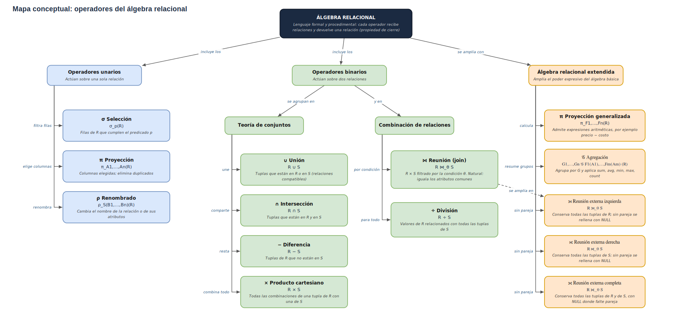

# Tarea 5.1: Mapa conceptual de operadores del álgebra relacional

📍 [Fundamentos de Bases de Datos](../../README.md) › [Unidad 5](../../README.md#unidad-5) › **Tarea 5.1**

**Tecnológico Nacional de México**
**Carrera:** Ingeniería Informática
**Materia:** Fundamentos de Base de Datos
**Unidad:** 5
**Alumna:** Gabriela Natalia De León Alvarez
**Matrícula:** I24050006

---

## 📌 Descripción

Mapa conceptual con la **notación formal y el significado** de los operadores del álgebra relacional:

- **Unarios:** selección σ, proyección π y renombrado ρ.
- **Binarios:** producto cartesiano ×, unión ∪, intersección ∩, diferencia −, división ÷ y reunión (join) ⋈.
- **Álgebra relacional extendida (marco teórico):** proyección generalizada, funciones de agregación 𝒢 y reuniones externas (left, right y full outer join).

Cada operador incluye su definición formal, un ejemplo con la tienda de abarrotes del proyecto y su equivalente en SQL.

## 📂 Contenido de la carpeta

| Archivo | Descripción |
|---|---|
| [Tarea5.1BasesDeDatos.pdf](Tarea5.1.pdf) | Documento PDF con el mapa conceptual y el marco teórico |
| [algebra-relacional.md](algebra-relacional.md) | Marco teórico completo en Markdown (con fórmulas y ejemplos) |
| [diagramas/mapa-algebra-relacional.svg](mapa-algebra-relacional.svg) | Mapa en formato vectorial |

## 🗺️ Vista previa del mapa conceptual

## 🛠️ Herramientas utilizadas

- [draw.io (diagrams.net)](https://app.diagrams.net/) y [Mermaid](https://mermaid.js.org/) para el mapa conceptual
- GitHub para el alojamiento

## 📚 Referencias (APA 7)

Codd, E. F. (1970). A relational model of data for large shared data banks. *Communications of the ACM, 13*(6), 377-387. https://doi.org/10.1145/362384.362685

Codd, E. F. (1972). Relational completeness of data base sublanguages. En R. Rustin (Ed.), *Data base systems* (pp. 65-98). Prentice-Hall.

Date, C. J. (2004). *An introduction to database systems* (8.ª ed.). Pearson/Addison-Wesley.

Elmasri, R., & Navathe, S. B. (2016). *Fundamentals of database systems* (7.ª ed.). Pearson.

Silberschatz, A., Korth, H. F., & Sudarshan, S. (2010). *Database system concepts* (6.ª ed.). McGraw-Hill.
