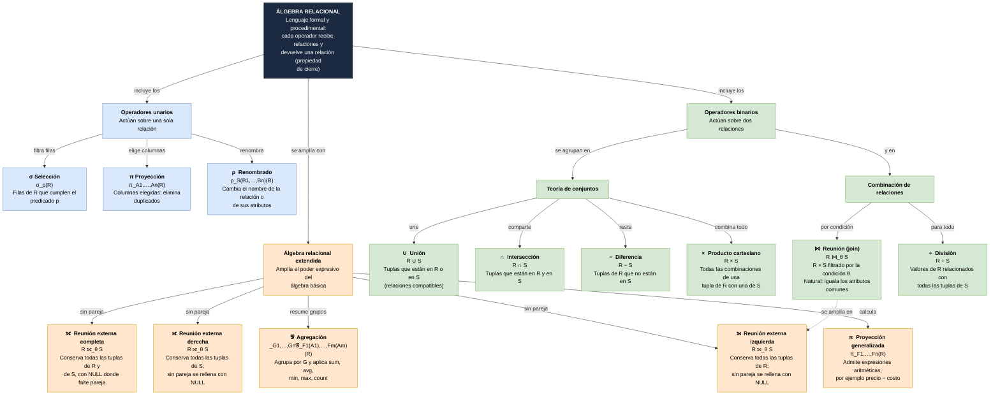

# Álgebra relacional: operadores básicos y extendidos

> Tarea 5.1, Unidad 5. Mapa conceptual con la notación formal y el significado de los operadores unarios y binarios, y marco teórico del álgebra relacional extendida. Los ejemplos usan la tienda de abarrotes del proyecto.

## 1. Marco teórico

### 1.1 ¿Qué es el álgebra relacional?
El **álgebra relacional** es un lenguaje formal y **procedimental** para consultar bases de datos relacionales: se indica *cómo* obtener el resultado combinando operadores. Fue propuesta por Codd (1970, 1972) y es la base teórica de SQL (Elmasri & Navathe, 2016; Silberschatz et al., 2010).

Sus propiedades principales son:
- **Cierre:** cada operador recibe una o dos relaciones y devuelve **otra relación**, por lo que los operadores se pueden anidar: $\pi_{nombre}(\sigma_{precio\_venta>20}(PRODUCTO))$.
- **Semántica de conjuntos:** en el álgebra pura una relación es un conjunto de tuplas, sin duplicados. SQL, en cambio, trabaja con *multiconjuntos* (admite duplicados) salvo que se use `DISTINCT`.
- **Operadores fundamentales:** selección, proyección, unión, diferencia, producto cartesiano y renombrado. Los demás (intersección, reunión y división) se pueden **derivar** de ellos.

### 1.2 Clasificación de los operadores
| Tipo | Operadores |
|---|---|
| **Unarios** (una relación) | Selección $\sigma$, proyección $\pi$, renombrado $\rho$ |
| **Binarios** (dos relaciones) | Unión $\cup$, intersección $\cap$, diferencia $-$, producto cartesiano $\times$, reunión $\bowtie$, división $\div$ |
| **Extendidos** | Proyección generalizada, agregación $\mathcal{G}$, reuniones externas ⟕ ⟖ ⟗ |

## 2. Mapa conceptual


Archivos del mapa:
- Fuente editable en draw.io: [`diagramas/mapa-algebra-relacional.drawio`](diagramas/mapa-algebra-relacional.drawio)
- Vectorial: [`diagramas/mapa-algebra-relacional.svg`](diagramas/mapa-algebra-relacional.svg)
- Código Mermaid: [`diagramas/mapa-algebra-relacional.mmd`](diagramas/mapa-algebra-relacional.mmd)

Versión en Mermaid (GitHub la dibuja directamente):



## 3. Relaciones de ejemplo

Para simplificar, los códigos de barras se abrevian como P1 a P4. Todas las relaciones salen del esquema de la tienda.

**PRODUCTO**

| codigo_barras | nombre | costo_compra | precio_venta | stock_actual | id_categoria |
|---|---|---|---|---|---|
| P1 | Refresco 600 ml | 10.00 | 15.00 | 20 | 1 |
| P2 | Arroz 1 kg | 18.00 | 25.00 | 8 | 2 |
| P3 | Frijol 1 kg | 22.00 | 30.00 | 12 | 2 |
| P4 | Aceite 1 L | 35.00 | 45.00 | 3 | 2 |

**CATEGORIA**

| id_categoria | nombre_cat |
|---|---|
| 1 | Bebidas |
| 2 | Abarrotes |
| 3 | Limpieza |

**DETALLE_VENTA** (productos vendidos)

| folio | codigo_barras | cantidad |
|---|---|---|
| 1 | P1 | 2 |
| 1 | P2 | 1 |
| 2 | P3 | 3 |
| 2 | P1 | 1 |
| 2 | P2 | 2 |
| 3 | P2 | 1 |

**ABASTECIMIENTO** (productos que surte el proveedor)

| id_proveedor | codigo_barras | costo_unitario |
|---|---|---|
| 1 | P1 | 9.00 |
| 1 | P2 | 16.50 |
| 1 | P4 | 33.00 |

## 4. Operadores unarios

### 4.1 Selección $\sigma$
- **Notación:** $\sigma_{p}(R)=\{\,t \mid t\in R \land p(t)\,\}$, donde $p$ es un predicado con comparaciones ($=, \neq, <, \le, >, \ge$) combinadas con $\land, \lor, \lnot$.
- **Significado:** devuelve las **filas** de $R$ que cumplen el predicado. Conserva todos los atributos. El grado no cambia y la cardinalidad es menor o igual.
- **Ejemplo:** productos con precio de venta mayor a 20: $\sigma_{precio\_venta>20}(PRODUCTO)$

| codigo_barras | nombre | costo_compra | precio_venta | stock_actual | id_categoria |
|---|---|---|---|---|---|
| P2 | Arroz 1 kg | 18.00 | 25.00 | 8 | 2 |
| P3 | Frijol 1 kg | 22.00 | 30.00 | 12 | 2 |
| P4 | Aceite 1 L | 35.00 | 45.00 | 3 | 2 |

- **SQL:** `SELECT * FROM producto WHERE precio_venta > 20;`

### 4.2 Proyección $\pi$
- **Notación:** $\pi_{A_1,\dots,A_n}(R)=\{\,t[A_1,\dots,A_n] \mid t\in R\,\}$
- **Significado:** devuelve solo las **columnas** indicadas y **elimina las filas duplicadas** (por ser un conjunto).
- **Ejemplo:** $\pi_{nombre,\,precio\_venta}(PRODUCTO)$

| nombre | precio_venta |
|---|---|
| Refresco 600 ml | 15.00 |
| Arroz 1 kg | 25.00 |
| Frijol 1 kg | 30.00 |
| Aceite 1 L | 45.00 |

- **Eliminación de duplicados:** $\pi_{id\_categoria}(PRODUCTO)$ devuelve solo 2 filas aunque hay 4 productos.

| id_categoria |
|---|
| 1 |
| 2 |

- **Composición:** nombres de los productos de la categoría 2: $\pi_{nombre}(\sigma_{id\_categoria=2}(PRODUCTO))$

| nombre |
|---|
| Arroz 1 kg |
| Frijol 1 kg |
| Aceite 1 L |

- **SQL:** `SELECT DISTINCT nombre, precio_venta FROM producto;`

### 4.3 Renombrado $\rho$
- **Notación:** $\rho_{S(B_1,\dots,B_n)}(R)$ da a la relación el nombre $S$ y a sus atributos los nombres $B_1,\dots,B_n$.
- **Significado:** no cambia los datos, solo los nombres. Es necesario, por ejemplo, para unir una relación consigo misma o para que dos relaciones sean compatibles en unión.
- **Ejemplo:** $\rho_{ARTICULO(articulo,\,precio)}(\pi_{nombre,\,precio\_venta}(\sigma_{id\_categoria=1}(PRODUCTO)))$

| articulo | precio |
|---|---|
| Refresco 600 ml | 15.00 |

- **SQL:** `SELECT nombre AS articulo, precio_venta AS precio FROM producto WHERE id_categoria = 1;`

## 5. Operadores binarios

### 5.1 Compatibilidad de unión
Para $\cup$, $\cap$ y $-$, las dos relaciones deben ser **compatibles en unión**: tienen el mismo número de atributos y los atributos correspondientes tienen dominios compatibles. El resultado toma los nombres de atributos de la primera relación.

En los ejemplos se usan las relaciones compatibles
$V=\pi_{codigo\_barras}(DETALLE\_VENTA)=\{P1,P2,P3\}$ (productos vendidos) y
$A=\pi_{codigo\_barras}(ABASTECIMIENTO)=\{P1,P2,P4\}$ (productos que surte el proveedor).

### 5.2 Unión $\cup$
- **Notación:** $R\cup S=\{\,t \mid t\in R \lor t\in S\,\}$
- **Significado:** todas las tuplas que están en $R$, en $S$ o en ambas, sin duplicados. $|R\cup S|\le |R|+|S|$.
- **Ejemplo:** $V\cup A$ (productos que se vendieron o que se surten)

| codigo_barras |
|---|
| P1 |
| P2 |
| P3 |
| P4 |

- **SQL:** `SELECT codigo_barras FROM detalle_venta UNION SELECT codigo_barras FROM abastecimiento;`

### 5.3 Intersección $\cap$
- **Notación:** $R\cap S=\{\,t \mid t\in R \land t\in S\,\}$. Es un operador **derivado**: $R\cap S=R-(R-S)$.
- **Significado:** tuplas que están en ambas relaciones.
- **Ejemplo:** $V\cap A$ (productos que se venden y que el proveedor surte)

| codigo_barras |
|---|
| P1 |
| P2 |

- **SQL:** `... INTERSECT ...`

### 5.4 Diferencia $-$
- **Notación:** $R-S=\{\,t \mid t\in R \land t\notin S\,\}$. **No es conmutativa**: $R-S\neq S-R$.
- **Significado:** tuplas de $R$ que no están en $S$.
- **Ejemplo:** $V-A$ (productos que se venden pero ningún proveedor surte):

| codigo_barras |
|---|
| P3 |

  y $A-V$ (productos que se surten pero no se han vendido):

| codigo_barras |
|---|
| P4 |

- **SQL:** `... EXCEPT ...`

### 5.5 Producto cartesiano $\times$
- **Notación:** $R\times S=\{\,t\,q \mid t\in R \land q\in S\,\}$
- **Significado:** combina cada tupla de $R$ con cada tupla de $S$. El grado es la suma de los grados y $|R\times S|=|R|\cdot|S|$.
- **Ejemplo:** $\pi_{nombre\_cat}(CATEGORIA)\times TURNO$, con $TURNO=\{MATUTINO,VESPERTINO\}$ (3 categorías × 2 turnos = 6 filas)

| nombre_cat | turno |
|---|---|
| Abarrotes | MATUTINO |
| Abarrotes | VESPERTINO |
| Bebidas | MATUTINO |
| Bebidas | VESPERTINO |
| Limpieza | MATUTINO |
| Limpieza | VESPERTINO |

- **SQL:** `SELECT c.nombre_cat, t.turno FROM categoria c CROSS JOIN turno t;`

### 5.6 Reunión (join) $\bowtie$
- **Reunión theta:** $R\bowtie_{\theta}S=\sigma_{\theta}(R\times S)$, donde $\theta$ es una condición entre atributos de $R$ y de $S$. Es un operador **derivado**: producto cartesiano seguido de selección.
- **Equirreunión:** caso en que $\theta$ solo usa igualdades.
- **Reunión natural:** $R\bowtie S$ iguala automáticamente los atributos que se llaman igual en ambas relaciones y **no repite** esas columnas en el resultado.
- **Ejemplo (natural):** $PRODUCTO\bowtie CATEGORIA$ (se unen por `id_categoria`)

| codigo_barras | nombre | id_categoria | nombre_cat |
|---|---|---|---|
| P1 | Refresco 600 ml | 1 | Bebidas |
| P2 | Arroz 1 kg | 2 | Abarrotes |
| P3 | Frijol 1 kg | 2 | Abarrotes |
| P4 | Aceite 1 L | 2 | Abarrotes |

- **Ejemplo (theta):** $PRODUCTO\bowtie_{PRODUCTO.codigo\_barras=ABASTECIMIENTO.codigo\_barras\ \land\ precio\_venta>1.5\cdot costo\_unitario}ABASTECIMIENTO$ (productos que se venden a más de 1.5 veces su costo de surtido)

| nombre | precio_venta | costo_unitario |
|---|---|---|
| Arroz 1 kg | 25.00 | 16.50 |
| Refresco 600 ml | 15.00 | 9.00 |

- **SQL:** `SELECT ... FROM producto p JOIN categoria c ON c.id_categoria = p.id_categoria;` SQL Server no tiene `NATURAL JOIN`, por lo que se escribe la condición con `ON`.

### 5.7 División $\div$
- **Notación:** si $R(X,Y)$ y $S(Y)$, entonces
  $R\div S=\{\,t[X] \mid t\in R \land \forall s\in S:\ (t[X],s)\in R\,\}$.
  Es un operador **derivado**: $R\div S=\pi_X(R)-\pi_X\big((\pi_X(R)\times S)-R\big)$.
- **Significado:** valores de $X$ que están relacionados con **todos** los valores de $S$. Responde consultas del tipo «para todo».
- **Ejemplo:** clientes que compraron **todos** los productos de la promoción. Con $COMPRA\_CLIENTE(id\_cliente,codigo\_barras)$ y $PROMOCION=\{P1,P2\}$:

| id_cliente | codigo_barras |
|---|---|
| 1 | P1 |
| 1 | P2 |
| 2 | P1 |
| 2 | P2 |
| 2 | P3 |
| 3 | P1 |

  $COMPRA\_CLIENTE\div PROMOCION$:

| id_cliente |
|---|
| 1 |
| 2 |

  El cliente 3 solo compró P1, por eso no aparece.
- **SQL:** no existe un operador directo; se usa doble `NOT EXISTS`:
```sql
SELECT DISTINCT c.id_cliente
FROM compra_cliente c
WHERE NOT EXISTS (
    SELECT 1 FROM promocion p
    WHERE NOT EXISTS (
        SELECT 1 FROM compra_cliente c2
        WHERE c2.id_cliente = c.id_cliente AND c2.codigo_barras = p.codigo_barras));
```

## 6. Álgebra relacional extendida

Los operadores básicos no pueden calcular valores nuevos, resumir grupos ni conservar filas sin pareja. El álgebra extendida agrega esas capacidades (Silberschatz et al., 2010).

### 6.1 Proyección generalizada
- **Notación:** $\pi_{F_1,F_2,\dots,F_n}(R)$, donde cada $F_i$ es una **expresión aritmética** sobre atributos y constantes (y puede renombrarse).
- **Significado:** extiende la proyección para producir columnas calculadas.
- **Ejemplo:** margen de ganancia: $\pi_{nombre,\ precio\_venta-costo\_compra\ \to\ margen}(PRODUCTO)$

| nombre | margen |
|---|---|
| Refresco 600 ml | 5.00 |
| Arroz 1 kg | 7.00 |
| Frijol 1 kg | 8.00 |
| Aceite 1 L | 10.00 |

- **SQL:** `SELECT nombre, precio_venta - costo_compra AS margen FROM producto;`

### 6.2 Funciones de agregación $\mathcal{G}$
- **Notación:** ${}_{G_1,\dots,G_n}\mathcal{G}_{F_1(A_1),\dots,F_m(A_m)}(R)$
  - $G_1,\dots,G_n$: atributos de **agrupación** (pueden omitirse; entonces todo $R$ es un solo grupo).
  - $F_i$: función de agregación sobre el atributo $A_i$: `sum`, `avg`, `min`, `max`, `count`.
- **Significado:** agrupa las tuplas con los mismos valores de $G$ y calcula una fila por grupo.
- **Ejemplo (con grupos):** número de productos y precio promedio por categoría: ${}_{id\_categoria}\mathcal{G}_{count(codigo\_barras),\ avg(precio\_venta)}(PRODUCTO)$

| id_categoria | num_productos | precio_promedio |
|---|---|---|
| 1 | 1 | 15.00 |
| 2 | 3 | 33.33 |

- **Ejemplo (sin grupos):** existencia total: $\mathcal{G}_{sum(stock\_actual)}(PRODUCTO)$

| total_stock |
|---|
| 43 |

- **SQL:** `SELECT id_categoria, COUNT(codigo_barras) AS num_productos, AVG(precio_venta) AS precio_promedio FROM producto GROUP BY id_categoria;`

### 6.3 Reuniones externas (outer join)
La reunión normal descarta las tuplas que no tienen pareja. Las **reuniones externas** las conservan y rellenan con `NULL` los atributos del otro lado:

| Operación | Notación | Conserva |
|---|---|---|
| Externa izquierda (*left outer join*) | $R\mathbin{⟕}_{\theta}S$ | Todas las tuplas de $R$ |
| Externa derecha (*right outer join*) | $R\mathbin{⟖}_{\theta}S$ | Todas las tuplas de $S$ |
| Externa completa (*full outer join*) | $R\mathbin{⟗}_{\theta}S$ | Todas las tuplas de $R$ y de $S$ |

Formalmente, $R\mathbin{⟕}_{\theta}S=(R\bowtie_{\theta}S)\ \cup\ \{\,(t,\text{null},\dots,\text{null}) \mid t\in R \text{ sin pareja en } S\,\}$. La derecha es simétrica y la completa es la unión de ambas.

- **Externa izquierda:** $CATEGORIA\mathbin{⟕}PRODUCTO$ (todas las categorías, aunque no tengan productos). La categoría *Limpieza* aparece con `NULL`:

| id_categoria | nombre_cat | codigo_barras | nombre |
|---|---|---|---|
| 1 | Bebidas | P1 | Refresco 600 ml |
| 2 | Abarrotes | P2 | Arroz 1 kg |
| 2 | Abarrotes | P3 | Frijol 1 kg |
| 2 | Abarrotes | P4 | Aceite 1 L |
| 3 | Limpieza | NULL | NULL |

  - **SQL:** `SELECT ... FROM categoria c LEFT JOIN producto p ON p.id_categoria = c.id_categoria;`

- **Externa derecha:** $PRODUCTO\mathbin{⟖}CATEGORIA$ devuelve las mismas filas, porque equivale a la izquierda con las relaciones invertidas.
  - **SQL:** `SELECT ... FROM producto p RIGHT JOIN categoria c ON p.id_categoria = c.id_categoria;`

- **Externa completa:** sea $VENTAS(codigo\_barras,cantidad\_vendida)={}_{codigo\_barras}\mathcal{G}_{sum(cantidad)}(DETALLE\_VENTA)$. Entonces $VENTAS\mathbin{⟗}ABASTECIMIENTO$ muestra todos los productos vendidos y todos los surtidos. P3 solo se vende y P4 solo se surte:

| codigo_barras | cantidad_vendida | costo_unitario |
|---|---|---|
| P1 | 3 | 9.00 |
| P2 | 4 | 16.50 |
| P3 | 3 | NULL |
| P4 | NULL | 33.00 |

  - **SQL:** `SELECT ... FROM (...) v FULL OUTER JOIN abastecimiento a ON a.codigo_barras = v.codigo_barras;`

## 7. Cuadro resumen

| Operador | Símbolo | Aridad | Notación | Resultado | Equivalente en SQL |
|---|---|---|---|---|---|
| Selección | $\sigma$ | Unario | $\sigma_p(R)$ | Filas que cumplen $p$ | `WHERE` |
| Proyección | $\pi$ | Unario | $\pi_{A_1..A_n}(R)$ | Columnas elegidas, sin duplicados | `SELECT DISTINCT` |
| Renombrado | $\rho$ | Unario | $\rho_{S(B_1..B_n)}(R)$ | Misma relación con otros nombres | `AS` |
| Unión | $\cup$ | Binario | $R\cup S$ | Tuplas en $R$ o en $S$ | `UNION` |
| Intersección | $\cap$ | Binario | $R\cap S$ | Tuplas en $R$ y en $S$ | `INTERSECT` |
| Diferencia | $-$ | Binario | $R-S$ | Tuplas de $R$ que no están en $S$ | `EXCEPT` |
| Producto cartesiano | $\times$ | Binario | $R\times S$ | Todas las combinaciones | `CROSS JOIN` |
| Reunión | $\bowtie$ | Binario | $R\bowtie_\theta S$ | $\sigma_\theta(R\times S)$ | `JOIN ... ON` |
| División | $\div$ | Binario | $R\div S$ | Valores asociados con todo $S$ | Doble `NOT EXISTS` |
| Proyección generalizada | $\pi$ | Unario | $\pi_{F_1..F_n}(R)$ | Columnas calculadas | `SELECT expresión` |
| Agregación | $\mathcal{G}$ | Unario | ${}_{G}\mathcal{G}_{F(A)}(R)$ | Una fila por grupo | `GROUP BY` + funciones |
| Reunión externa | ⟕ ⟖ ⟗ | Binario | $R\mathbin{⟕}_\theta S$ | Conserva filas sin pareja (`NULL`) | `LEFT / RIGHT / FULL OUTER JOIN` |

## 8. Operadores derivados

Algunos operadores se pueden expresar con los fundamentales, por lo que no aumentan el poder del lenguaje:

| Operador | Expresión con operadores fundamentales |
|---|---|
| Intersección | $R\cap S=R-(R-S)$ |
| Reunión theta | $R\bowtie_\theta S=\sigma_\theta(R\times S)$ |
| División | $R\div S=\pi_X(R)-\pi_X\big((\pi_X(R)\times S)-R\big)$ |

## Referencias

Codd, E. F. (1970). A relational model of data for large shared data banks. *Communications of the ACM, 13*(6), 377-387. https://doi.org/10.1145/362384.362685

Codd, E. F. (1972). Relational completeness of data base sublanguages. En R. Rustin (Ed.), *Data base systems* (pp. 65-98). Prentice-Hall.

Date, C. J. (2004). *An introduction to database systems* (8.ª ed.). Pearson/Addison-Wesley.

Elmasri, R., & Navathe, S. B. (2016). *Fundamentals of database systems* (7.ª ed.). Pearson.

Silberschatz, A., Korth, H. F., & Sudarshan, S. (2010). *Database system concepts* (6.ª ed.). McGraw-Hill.
